# AndiGenerator.NET – Anleitung

AndiGenerator.NET erstellt Spielpläne für Tischtennis-Staffeln. Grundlage sind die Terminwünsche, die die Vereine in click-TT gemeldet haben. Das Programm plant auf zwei Arten: **normale Runden** optimiert es so lange, bis Sie zufrieden sind (Kapitel [5](#5-normale-runden-optimieren)); für Klassen, die eine Halbrunde in **Kompaktspieltagen** spielen, baut es Pläne aus 3er- und 4er-Spieltagen in einer Halle (Kapitel [6](#6-kompaktspieltage-planen)). In beiden Fällen exportiert es das Ergebnis als CSV-Datei für den Import in click-TT.

AndiGenerator.NET ist die Weiterentwicklung des **AndiGenerators** von Andreas Hofmann. Die Optimierung normaler Runden, die Bewertung der Pläne und die Dateiformate stammen aus seinem Programm und rechnen genauso. Neu sind die Oberfläche, die Bedienung und die Planung von Kompaktspieltagen. Diese Anleitung beschreibt die neue Oberfläche; die fachlichen Abschnitte zu normalen Runden folgen inhaltlich der Anleitung des Originals.

**Inhalt**

1. [Allgemeines](#1-allgemeines)
2. [Installation](#2-installation)
3. [Erste Schritte](#3-erste-schritte) – Staffel öffnen und einrichten, [Zwei Arten zu planen](#35-zwei-arten-zu-planen)
4. [Das Hauptfenster](#4-das-hauptfenster)
5. [Normale Runden optimieren](#5-normale-runden-optimieren)
   - [Der Weg zum Plan](#51-der-weg-zum-plan) · [Die Kacheln](#52-die-kacheln) · [Die Generierung steuern](#53-die-generierung-steuern) · [Der Automodus](#54-der-automodus) · [Der Leitstand](#55-der-leitstand) · [Der Verlauf](#56-der-verlauf)
   - [Kosten](#57-kosten) · [Qualität](#58-qualität) · [Meldungen](#59-meldungen) · [Gewichtungen anpassen](#510-gewichtungen-anpassen) · [Pläne merken und vergleichen](#511-pläne-merken-und-vergleichen)
   - [Runden](#512-runden) · [Bewertung der Pläne (Kosten)](#513-bewertung-der-pläne-kosten)
6. [Kompaktspieltage planen](#6-kompaktspieltage-planen)
   - [Was sind Kompaktspieltage?](#61-was-sind-kompaktspieltage) · [Der Weg zum Plan](#62-der-weg-zum-plan) · [Der Kompaktmodus](#63-der-kompaktmodus) · [Meldungen und Daten aus click-TT](#64-meldungen-und-daten-aus-click-tt)
   - [Pläne berechnen](#65-pläne-berechnen) · [Pläne und Punkte](#66-pläne-und-punkte) · [Meldungen und Plan, Karte](#67-meldungen-und-plan-karte) · [Spieltage und Hinweise](#68-spieltage-und-hinweise) · [Meldungen im Raster bearbeiten](#69-meldungen-im-raster-bearbeiten)
   - [Pläne sichern und merken](#610-pläne-sichern-und-merken) · [Drucken und Export für click-TT](#611-drucken-und-export-für-click-tt) · [Grenzen](#612-grenzen)
7. [Ansichten für beide Arten der Planung](#7-ansichten-für-beide-arten-der-planung) – Terminplan, Diagramme, Terminwünsche, Nachbarmannschaften
8. [Export und Druck](#8-export-und-druck)
9. [Spielplandaten bearbeiten](#9-spielplandaten-bearbeiten)
10. [Tipps und häufige Fragen](#10-tipps-und-häufige-fragen)

---

## 1. Allgemeines

AndiGenerator.NET ist Freie Software: Sie können es unter den Bedingungen der GNU General Public License Version 3 weitergeben und verändern. Das Programm wird in der Hoffnung bereitgestellt, dass es nützlich ist, aber **ohne jede Gewährleistung**, auch ohne die stillschweigende Gewährleistung der Marktreife oder der Eignung für einen bestimmten Zweck. Den Lizenztext finden Sie unter <https://www.gnu.org/licenses/gpl-3.0.html> und im Dialog **Über**.

**Wo das Programm seine Daten ablegt**

| Was | Wo |
|---|---|
| Die click-TT-Datei (XML) | dort, wo Sie sie gespeichert haben |
| Ihre Änderungen an den Spielplandaten | als Datei mit der Endung `.modifications` neben der XML-Datei |
| Einstellungen und gemerkte Pläne je Staffel | im Ordner `%LOCALAPPDATA%\AndiGenerator.NET` |

Wenn Sie vorher mit dem Original-AndiGenerator gearbeitet haben, übernimmt AndiGenerator.NET beim ersten Öffnen einer Staffel deren Einstellungen und gemerkte Pläne als **Kopie**. Die Dateien des Originals werden nicht verändert; Sie können beide Programme nebeneinander verwenden. Eine vorhandene `.modifications`-Datei wird von beiden Programmen gelesen.

## 2. Installation

AndiGenerator.NET läuft unter Windows 10 und 11 (64 Bit), auf dem Mac (macOS 14 oder neuer), auf Chromebooks und unter Linux (siehe unten). Administratorrechte sind nicht nötig, und .NET muss nicht installiert sein – alles Nötige ist dabei.

**Welche Datei?** Ein Klick lädt jeweils die neueste Version:

| Ihr Rechner | Datei |
|---|---|
| Windows-PC oder -Laptop (Intel/AMD – der Normalfall) | [AndiGeneratorNET-win-Setup.exe](https://github.com/PBuchmann/AndiGenerator.NET/releases/latest/download/AndiGeneratorNET-win-Setup.exe) |
| Windows-Laptop mit ARM-Prozessor (z. B. Snapdragon) | [AndiGeneratorNET-win-arm64-Setup.exe](https://github.com/PBuchmann/AndiGenerator.NET/releases/latest/download/AndiGeneratorNET-win-arm64-Setup.exe) |
| Mac mit Apple-Chip (M1 und neuer) | [AndiGeneratorNET-macos-arm64.dmg](https://github.com/PBuchmann/AndiGenerator.NET/releases/latest/download/AndiGeneratorNET-macos-arm64.dmg) |
| Mac mit Intel-Prozessor | [AndiGeneratorNET-macos-x64.dmg](https://github.com/PBuchmann/AndiGenerator.NET/releases/latest/download/AndiGeneratorNET-macos-x64.dmg) |
| Chromebook oder Linux mit Intel/AMD | [andigenerator-net_amd64.deb](https://github.com/PBuchmann/AndiGenerator.NET/releases/latest/download/andigenerator-net_amd64.deb) |
| Chromebook oder Linux mit ARM-Prozessor | [andigenerator-net_arm64.deb](https://github.com/PBuchmann/AndiGenerator.NET/releases/latest/download/andigenerator-net_arm64.deb) |

Im Zweifel bei Windows die erste Datei nehmen: Sie läuft auch auf ARM-Laptops mit Windows 11, nur langsamer. Die übrigen Dateien auf der Release-Seite (`.nupkg`, `RELEASES`, `releases.*.json`, Stückliste) braucht das Programm für seine Updates bzw. dienen als Nachweis – sie müssen Sie nicht herunterladen.

**Mit Setup (empfohlen)**

1. Auf der Seite [Releases](https://github.com/PBuchmann/AndiGenerator.NET/releases) bei der neuesten Version die Datei `AndiGeneratorNET-win-Setup.exe` herunterladen. Für Windows-Laptops mit ARM-Prozessor (z. B. Snapdragon) gibt es `AndiGeneratorNET-win-arm64-Setup.exe`; sie rechnet dort deutlich schneller. Welcher Prozessor eingebaut ist, steht unter *Einstellungen → System → Info → Systemtyp* („ARM-basierter Prozessor“).
2. Die Datei starten. Das Programm wird für Ihr Benutzerkonto installiert (im Ordner `%LOCALAPPDATA%\AndiGeneratorNET`), erscheint im Startmenü und auf dem Desktop und startet gleich.

**Ohne Installation**

Stattdessen `AndiGeneratorNET-win-Portable.zip` (bzw. `AndiGeneratorNET-win-arm64-Portable.zip`) herunterladen, in einen beliebigen Ordner entpacken und dort `AndiGenerator.NET.exe` starten. Diese Variante eignet sich z. B. für einen USB-Stick.

**Warnung von Windows beim ersten Start**

Solange das Programm noch nicht digital signiert ist, warnt Windows beim ersten Start („Der Computer wurde durch Windows geschützt“). Klicken Sie auf **Weitere Informationen** und dann auf **Trotzdem ausführen**. Ist bei Ihnen die *Intelligente App-Steuerung* von Windows 11 eingeschaltet, lässt sich das Programm bis zur Signierung nicht starten.

**Updates**

Das installierte Programm sucht nach dem Start selbst nach einer neuen Version und lädt sie im Hintergrund. Danach fragt es, ob es gleich neu starten soll; andernfalls wird die neue Version beim nächsten Beenden eingespielt. Ihre Einstellungen, gemerkten Pläne und Staffeldateien bleiben dabei erhalten. Dabei fragt das Programm nur GitHub nach der neuesten Version; Daten aus Ihren Staffeln werden nicht übertragen. Wer das nicht möchte, schaltet im Dialog **Über** die Einstellung **Beim Start nach neuen Versionen suchen** ab.

**Deinstallieren**

Über *Einstellungen → Apps → Installierte Apps → AndiGenerator.NET → Deinstallieren*. Ihre Daten im Ordner `%LOCALAPPDATA%\AndiGenerator.NET` und Ihre click-TT-Dateien bleiben erhalten.

**Auf dem Mac**

1. Auf der Seite [Releases](https://github.com/PBuchmann/AndiGenerator.NET/releases) das passende Disk-Image herunterladen: `AndiGeneratorNET-macos-arm64.dmg` für Macs mit Apple-Chip (M1 und neuer), `AndiGeneratorNET-macos-x64.dmg` für ältere Macs mit Intel-Prozessor. Welcher Chip eingebaut ist, steht unter * → Über diesen Mac*.
2. Das Disk-Image öffnen und **AndiGenerator.NET** auf den Ordner **Programme** ziehen.
3. Beim ersten Start meldet macOS, dass Apple das Programm nicht überprüfen konnte, und öffnet es nicht – das Programm ist noch nicht von Apple beglaubigt. Die Meldung mit **Fertig** schließen, dann *Systemeinstellungen → Datenschutz & Sicherheit* öffnen, nach unten blättern und bei AndiGenerator.NET **Dennoch öffnen** wählen und mit dem Passwort bestätigen. Danach startet das Programm normal.

Statt **Strg** gilt auf dem Mac die Befehlstaste **⌘** (z. B. ⌘ + Plus zum Vergrößern). Die eigenen Daten liegen im Ordner `~/Library/Application Support/AndiGenerator.NET`. Neue Versionen werden auf dem Mac nicht selbst gesucht – zum Aktualisieren das neue Disk-Image herunterladen und das Programm genauso in *Programme* ziehen (ersetzen).

**Auf einem Chromebook (und unter Linux)**

Auf Chromebooks läuft das Programm in der Linux-Entwicklungsumgebung, die ChromeOS mitbringt.

1. Einmalig Linux einschalten: *Einstellungen → Info zu ChromeOS → Entwickler → Linux-Entwicklungsumgebung → Aktivieren* (bei älteren Versionen *Einstellungen → Erweitert → Entwickler*).
2. Auf der Seite [Releases](https://github.com/PBuchmann/AndiGenerator.NET/releases) das passende Paket herunterladen: `andigenerator-net_amd64.deb` für Chromebooks mit Intel- oder AMD-Prozessor, `andigenerator-net_arm64.deb` für Chromebooks mit ARM-Prozessor (z. B. MediaTek oder Qualcomm). Welcher Prozessor eingebaut ist, steht unter *Einstellungen → Info zu ChromeOS → Weitere Details*, oder im Linux-Terminal mit `dpkg --print-architecture`.
3. Die Datei in der App *Dateien* in den Ordner *Linux-Dateien* ziehen.
4. Das *Terminal* öffnen (im Launcher unter *Linux-Apps*) und eingeben – mit dem Dateinamen der heruntergeladenen Datei:
   `sudo apt install ./andigenerator-net_amd64.deb` (bzw. `…_arm64.deb`)
   ChromeOS bietet die Installation per Doppelklick nicht mehr an. Das Programm erscheint danach im Launcher im Ordner *Linux-Apps*.
5. Die click-TT-Dateien müssen für Linux sichtbar sein: entweder in den Ordner *Linux-Dateien* legen oder einen Ordner in *Dateien* mit der rechten Maustaste **Mit Linux teilen**.

Ohne Installation geht es mit `AndiGeneratorNET-linux-x64.tar.gz` bzw. `AndiGeneratorNET-linux-arm64.tar.gz`: entpacken und `./AndiGenerator.NET` starten. Unter Linux liegen die eigenen Daten im Ordner `~/.local/share/AndiGenerator.NET`. Neue Versionen werden hier nicht selbst gesucht – zum Aktualisieren das neue Paket genauso installieren.

## 3. Erste Schritte

Ob normale Runde oder Kompaktspieltage – die ersten Schritte sind dieselben: Terminwünsche aus click-TT herunterladen, die Staffel öffnen und einrichten. Danach trennen sich die Wege (Abschnitt [3.5](#35-zwei-arten-zu-planen)); gemeinsam bleiben die Ansichten Terminplan, Diagramme, Terminwünsche und Nachbarmannschaften, Export und Druck sowie die Spielplandaten (Kapitel [7](#7-ansichten-für-beide-arten-der-planung) bis [9](#9-spielplandaten-bearbeiten)).

### 3.1 Terminwünsche aus click-TT herunterladen

Das Programm braucht die Terminmeldungen der Staffel. click-TT stellt sie als XML-Datei bereit, die ursprünglich für den Meinl-Generator gedacht war:

1. In click-TT als Staffelleiter anmelden.
2. **Spielbetrieb Organisation** öffnen und die Staffel wählen.
3. Oben rechts bei den Downloads **Terminmeldung für Meinl-Generator (xml)** anklicken und die Datei speichern.

Die Datei enthält die Terminwünsche aller Mannschaften und die schon terminierten Spiele der Nachbarmannschaften aus anderen Staffeln.

> **Tipp:** Laden Sie die XML-Datei immer unter demselben Namen in denselben Ordner. Dann bleiben Ihre Änderungen (`.modifications`) erhalten, auch wenn Sie die Datei später neu herunterladen, weil sich in click-TT etwas geändert hat.

### 3.2 Staffel öffnen

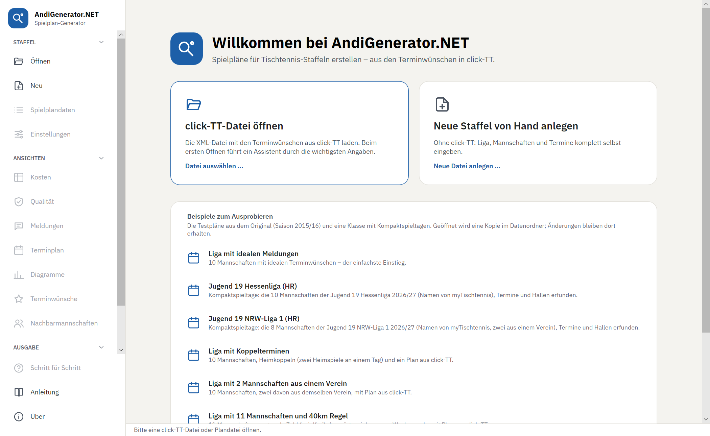

Auf der Startseite **click-TT-Datei öffnen** wählen, oder links **Öffnen**. Im Dateidialog können Sie zusammen mit der XML-Datei gleich die beiden weiteren Downloads der Staffel markieren (mit gedrückter **Strg**-Taste): die **Mannschaftsmeldung (CSV)** und den Bericht **Terminwünsche (PDF)**. Das Programm übernimmt jede dieser Dateien, wenn alle Mannschaften der Staffel darin vorkommen – genau so, als hätten Sie sie in der Einrichtung unter *Daten aus click-TT ergänzen* geladen und übernommen (die Mannschaftsmeldung auch als Setzliste); mit beiden Dateien ist dieser Punkt dann schon erledigt. Passt eine Datei nicht zur Staffel (z. B. aus einer anderen Klasse), bleibt sie unberücksichtigt, und die Einrichtung sagt, welche Mannschaften fehlen. Zuletzt geöffnete Staffeln stehen in der Liste darunter und öffnen sich mit einem Klick; mit dem **×** am Ende einer Zeile entfernen Sie einen Eintrag aus der Liste (die Datei selbst bleibt erhalten).

Ohne click-TT können Sie mit **Neu** eine leere Plandatei anlegen und Liga, Mannschaften und Termine von Hand eingeben. Die Eingabemasken sind dafür aber eher zum Korrigieren gedacht als zum Erfassen einer ganzen Staffel.

### 3.3 Die Staffel einrichten

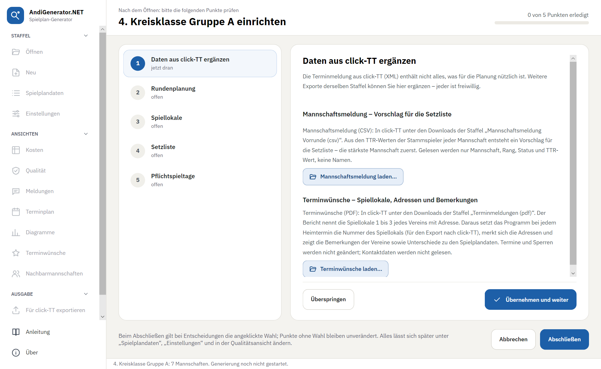

click-TT überträgt nicht alles, was für einen guten Plan nötig ist, und die Meldungen der Vereine enthalten gelegentlich Fehler. Nach dem Öffnen zeigt das Programm deshalb eine Seite mit den Punkten, die Sie prüfen sollten. Welche Punkte erscheinen, hängt von der Staffel ab:

| Punkt | Worum es geht |
|---|---|
| **Daten aus click-TT ergänzen** | Immer als erster Punkt: weitere Exporte aus click-TT, die nicht in der XML-Datei stehen (siehe unten). Jeder ist freiwillig – außer bei Klassen mit Kompaktspieltagen, für die der Bericht *Terminwünsche* Pflicht ist. Erledigt ist der Punkt erst, wenn Mannschaftsmeldung **und** Terminwünsche übernommen sind – das darf auch in verschiedenen Sitzungen geschehen; die Seite nennt bei jeder Datei, wann sie übernommen wurde. Ist beides erledigt und sonst nichts zu klären, erscheint die Einrichtung nicht. |
| **Gespeicherte Einstellungen** | Sie haben die Staffel schon einmal bearbeitet und dabei Gewichtungen geändert. Wählen Sie, ob Sie diese weiterverwenden oder für diese Sitzung mit den Standardeinstellungen rechnen wollen (die gespeicherten bleiben erhalten). |
| **Gespeicherte Kriterienreihenfolge** | Sie haben für diese Staffel in der Ansicht **Qualität** eine eigene Einteilung der Kriterien in die Stufen A, B und C festgelegt (danach richtet sich der Automodus). Die Seite zeigt sie; wählen Sie, ob Sie sie weiterverwenden oder für diese Sitzung die Standardreihenfolge nehmen (die gespeicherte bleibt erhalten, bis Sie die Einteilung wieder ändern). |
| **Rundenplanung** | Ist die Runde kürzer als sechs Monate, schlägt das Programm eine Halbrunde vor. Beginnt die Rückrunde in weniger als 60 Tagen (oder hat sie vor weniger als 60 Tagen begonnen), schlägt es vor, nur die Rückrunde zu planen; die Frage nennt dazu den Beginn der Rückrunde. Enthält der Klassenname „(HR)“ (Hinrunde bzw. Herbstrunde) oder „(FR)“ (Finalrunde bzw. Frühlingsrunde), spielt die Klasse nur eine Halbrunde: Dann wird ohne Frage nur die Hinrunde bzw. nur die Rückrunde geplant; in den Einstellungen ist die Rundenplanung dann fest. |
| **Klasse mit Kompaktspieltagen** | Nur bei einer Halbrunde, deren Spieltage überwiegend am Wochenende liegen: Erklärung der Kompaktspieltage und die Wahl, ob die Staffel so geplant wird. Siehe Abschnitt [6.3](#63-der-kompaktmodus). |
| **Spiellokale** | click-TT überträgt keine Nummern der Spiellokale, wohl aber die Namen der Hallen. Das Programm vergleicht die Hallenbelegung deshalb nach dem Hallennamen: Ein Heimspiel einer Nachbarmannschaft in einer anderen Halle belegt die eigene Halle nicht. Die Nummern (1, 2, 3) brauchen Sie für den Export nach click-TT und für von Hand angelegte Termine ohne Hallennamen. Haben alle Vereine nur eine Halle, können Sie den Punkt überspringen. |
| **Koppeltermine** | Die Staffel enthält Koppelwünsche oder mögliche Doppelspieltage. Das Programm leitet sie aus den Meldungen ab; bitte kontrollieren. |
| **Auswärtskoppelwünsche** | Mannschaften möchten zwei Auswärtsspiele an einem Wochenende zusammenlegen. Bitte kontrollieren. |
| **Setzliste** | Wenn Sie mit einer Setzliste arbeiten wollen, geben Sie hier die erwartete Abschlusstabelle vor. |
| **Pflichtspieltage** | Die Staffel enthält Pflichtspieltage. Sie sind bei ungerader Mannschaftszahl problematisch (siehe [Pflichtspieltage](#pflichtspieltage)). |

Jeder Punkt lässt sich direkt auf der Seite bearbeiten; mit **Auswahl übernehmen** ist er erledigt, mit **Überspringen** bleibt er, wie er ist. Unten beendet **Abschließen** die Einrichtung; **Abbrechen** schließt die Staffel wieder (schon übernommene Punkte bleiben gespeichert). Solange die Einrichtung offen ist, sind auch **Öffnen** und **Neu** gesperrt – erst abschließen oder abbrechen. Bei Entscheidungen gilt dabei die angeklickte Wahl, auch ohne **Auswahl übernehmen**; Punkte, bei denen Sie nichts gewählt haben, bleiben unverändert. Die Wahlkacheln und Knöpfe stehen immer unten im Blick, auch wenn die Erklärung darüber lang ist. Alles lässt sich später unter **Spielplandaten**, **Einstellungen** und in der Ansicht **Qualität** ändern.

**Daten aus click-TT ergänzen.** Hier gibt es zwei Dateien. Die **Mannschaftsmeldung**: In click-TT stehen bei den Downloads der Staffel die Dateien **Mannschaftsmeldung Vorrunde (csv)** bzw. **Rückrunde (csv)**. Nach **Mannschaftsmeldung laden…** zeigt das Programm je Mannschaft den Schnitt der TTR-Werte ihrer besten Stammspieler – bei Vierer-Mannschaften der besten vier, bei Sechser-Mannschaften der besten sechs; Reservespieler zählen nicht – und ordnet die Mannschaften danach, die stärkste zuerst. Mit dem Haken **Als Setzliste übernehmen** wird diese Reihenfolge die Setzliste (und die Setzliste eingeschaltet); im Punkt **Setzliste** können Sie sie danach wie gewohnt verschieben. Bei Kompaktspieltagen bestimmen die Schnitte den Spitzen- und den Abstiegsspieltag. Gelesen werden nur Mannschaft, Rang, Status und TTR-Wert – keine Namen oder Geburtsdaten.

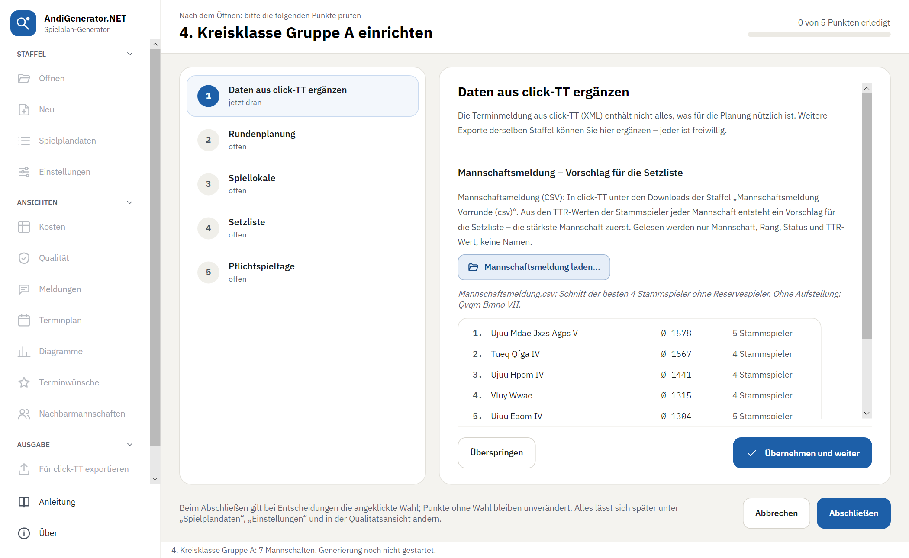

Die **Terminwünsche** (PDF): In click-TT bei den Downloads der Staffel **Terminmeldungen (pdf)**. Der Bericht nennt die Spiellokale 1 bis 3 jedes Vereins mit Adresse. Nach **Terminwünsche laden…** setzt das Programm bei jedem Heimtermin die Nummer des Spiellokals, dessen Name zur Halle aus click-TT passt – die Nummern braucht der Export nach click-TT, und von Hand eingetragene Nummern bleiben unverändert. Außerdem merkt es sich die Adressen (für die Entfernungen zwischen den Hallen, siehe unten), zeigt die **Bemerkungen der Vereine** – Wünsche, die click-TT nicht strukturiert überträgt, etwa „alle Spiele nur samstags“ – und listet **Unterschiede** zwischen Bericht und Spielplandaten, z. B. Heim- oder Sperrtermine, die ein Verein nach dem Herunterladen der XML-Datei geändert hat oder die Sie selbst angepasst haben. Termine und Sperren selbst ändert der Bericht nicht. Kontaktdaten werden nicht gelesen.

Nach dem Laden erscheint direkt unter dem jeweiligen Knopf eine hervorgehobene Meldung mit grünem Haken und dem Wichtigsten (z. B. wie viele Mannschaften gefunden wurden und wie viele Unterschiede es gibt), und die Seite rollt dorthin; die Einzelheiten stehen darunter.

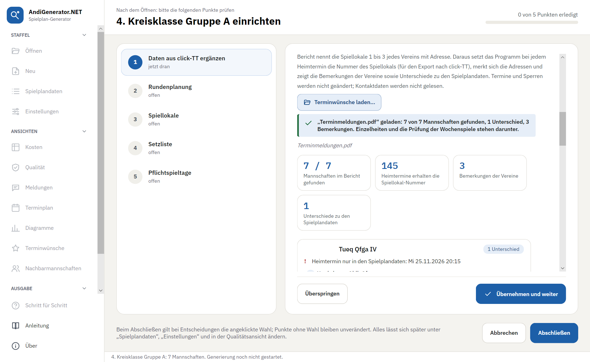

**Wochenspiele (60-km-Regel).** Sobald Hallenadressen bekannt sind, prüft die Seite die Liste „keine Auswärtsspiele unter der Woche“ (Spielplandaten, Seite [Wochenende (60-km-Regel)](#wochenende-60-km-regel)). Gemessen wird die **Luftlinie** zwischen den Hallen, aus Postleitzahl und Ort – deutschlandweit und ohne Internet. Die Prüfung läuft sofort auf der Seite, sobald Hallenadressen bekannt sind, und erneut, wenn Sie die Grenze ändern (Vorgabe 60 km); sie ändert nichts an den Daten. Für den Plan zählen allein die Häkchen auf der Seite *Wochenende (60-km-Regel)*. Geprüft wird ein Paar nur, wenn der Gastgeber Heimtermine **unter der Woche und am Wochenende** gemeldet hat – nur dann entscheidet die Sperre, wann gespielt wird. Unter der Woche heißt Montag bis Donnerstag, der Freitag nur, wenn er in den **Einstellungen** nicht zum Wochenende zählt. Hat in der Staffel niemand solche Termine (etwa in einer Verbandsliga, die nur samstags und sonntags spielt), sagt die Seite das, und es gibt nichts zu prüfen. **Sperre fehlt vermutlich:** Die Hallen liegen weiter auseinander als die Grenze, aber der Gast hat den Gastgeber nicht gesperrt. **Sperre vermutlich unnötig:** gesperrt, obwohl die Hallen höchstens so weit auseinander liegen. Sperrt ein Verein pauschal alle Gegner, ist das sein Wunsch – die Seite nennt ihn, bewertet ihn aber nicht. Da die Wettspielordnung kein festes Maß vorgibt, sind das zunächst nur Hinweise. Mit **Fehlende Sperren setzen…** setzen Sie nach einer einzigen Rückfrage (sie listet alle Treffer) alle fehlenden Sperren auf einmal; vorhandene bleiben. Danach zeigt das **Protokoll** auf der Seite Zeitpunkt, Grenze und je Sperre „Gast spielt bei Gastgeber nur am Wochenende (km)“. Gespeichert wird mit der Seite; **Standard** nimmt die gesetzten Sperren wieder zurück. Unnötige Sperren ändert das Programm nicht.

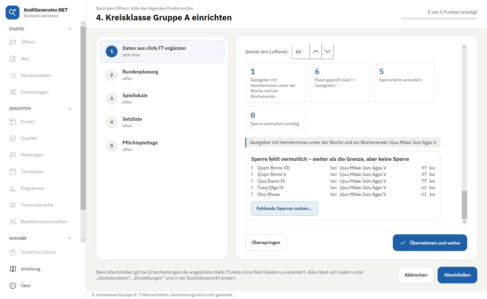

### 3.4 Terminwünsche kontrollieren

Bevor Sie planen, lohnt ein Blick in die Ansicht **Terminwünsche** (links unter *Ansichten*). Sie zeigt, was die Vereine gemeldet haben, und markiert Probleme – zum Beispiel eine Mannschaft, die zu wenige Heimtermine gemeldet hat. Ein Plan lässt sich trotzdem erzeugen; es bleiben dann aber Spiele ohne Termin. Einzelheiten in Abschnitt [7.3](#73-terminwünsche). Bei Kompaktspieltagen zeigt das Raster der Ansicht **Kompaktspieltage** die Meldungen noch übersichtlicher (Abschnitt [6.7](#67-meldungen-und-plan-karte)).

### 3.5 Zwei Arten zu planen

Nach der Einrichtung plant das Programm die Staffel auf eine von zwei Arten. Welche gilt, ergibt sich aus der Einrichtung: Wer bei einer passenden Klasse die Kompaktspieltage wählt, arbeitet im **Kompaktmodus**, alle anderen Staffeln planen **normale Runden**.

| | Normale Runden | Kompaktspieltage |
|---|---|---|
| **Für** | jede Staffel: Vor- und Rückrunde, Halbrunde, Doppelrunde | Halbrunden mit Spieltagen überwiegend am Wochenende, z. B. Jugend-Verbandsoberliga |
| **Spiele** | jedes Spiel an einem eigenen Termin der Heimmannschaft | drei oder vier Mannschaften treffen sich an einem Tag in einer Halle |
| **Rechnen** | lange Suche, die den Plan immer weiter verbessert (Kostenoptimierung oder Automodus) | gezielte Berechnung mit dem Löser HiGHS; nach kurzer Zeit liegen mehrere fertige Varianten vor |
| **Bewertung** | Kosten mit Ihren Gewichtungen, Verstöße nach Stufen A, B und C | Punkte für Verstöße, fehlende Heimspieltage, Fahrten, Stand und weitere Ziele |
| **Hauptansichten** | Kosten, Qualität, Meldungen, Leitstand, Verlauf | Kompaktspieltage: Pläne, Raster, Karte, Spieltage |
| **Beschrieben in** | Kapitel [5](#5-normale-runden-optimieren) | Kapitel [6](#6-kompaktspieltage-planen) |

## 4. Das Hauptfenster

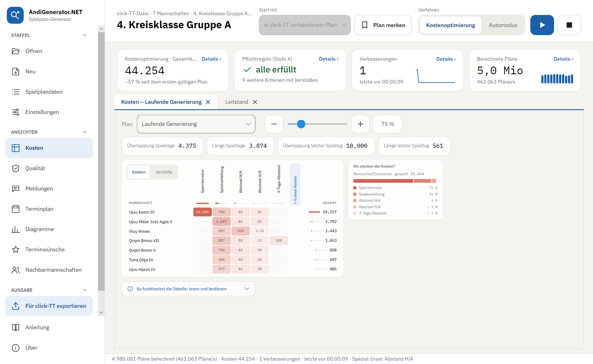

**Links** stehen alle Befehle:

- **Staffel:** Öffnen, Neu, Spielplandaten, Einstellungen
- **Ansichten:** Kosten, Qualität, Meldungen, Terminplan, Diagramme, Terminwünsche, Nachbarmannschaften, bei Halbrunden Kompaktspieltage
- **Ausgabe:** Für click-TT exportieren (farblich hervorgehoben), Drucken (PDF)
- **Anleitung:** öffnet diese Anleitung als PDF
- **Über:** Version, Urheber und Lizenzen

Die Abschnitte *Staffel*, *Ansichten* und *Ausgabe* lassen sich mit einem Klick auf ihre Überschrift zu- und wieder aufklappen; so bleibt die Leiste auch auf kleinen Bildschirmen übersichtlich.

**Oben** stehen links der Name der Staffel und die Datei, rechts die Steuerung: **Start mit**, **Plan merken**, **Verfahren** (Kostenoptimierung oder Automodus), **▶ Start** bzw. **⏸ Pausieren** und daneben **✕ Staffel schließen** (führt zur Startseite zurück) bzw. während der Generierung **■ Stopp**. Wählen Sie unter **Start mit** einen vorhandenen Plan (gemerkt oder aus click-TT), zeigen alle Ansichten und die Kacheln sofort diesen Plan – mit Kosten und Qualität –, ohne dass eine Optimierung startet und ihn verändert.

Darunter stehen **Kacheln** mit dem Stand der Generierung (Abschnitt [5.2](#52-die-kacheln)).

Im **Kompaktmodus** sieht das Hauptfenster etwas anders aus: Die Ansicht *Kompaktspieltage* ist die Hauptansicht, *Kosten*, *Qualität* und *Meldungen* sowie die Wahl des Verfahrens entfallen, und ▶ berechnet die Pläne der Kompaktspieltage (Abschnitt [6.3](#63-der-kompaktmodus)).

Den **Hauptbereich** füllen die Ansichten. Jede Ansicht öffnet sich als Reiter; Sie können mehrere öffnen, zwischen ihnen wechseln, sie per Maus nebeneinander anordnen und mit dem **×** am Reiter schließen. In vielen Ansichten vergrößert oder verkleinert **Strg + Mausrad** (auf dem Mac auch **⌘ + Mausrad**, oder der Zoomregler) die Darstellung.

Ganz unten zeigt die **Statuszeile** den Stand in einer Zeile.

## 5. Normale Runden optimieren

Für normale Runden sucht das Programm den Plan, der die Wünsche der Vereine am besten erfüllt. Es bewertet jeden Plan mit **Kosten** und verbessert ihn durch Millionen kleiner Tauschaktionen – so lange, bis Sie zufrieden sind. Dieses Kapitel beschreibt den Ablauf, die Steuerung der Suche, die Ansichten zur Beurteilung und die Gewichtungen.

### 5.1 Der Weg zum Plan

Ist die Staffel eingerichtet und sind die Terminwünsche kontrolliert (Kapitel [3](#3-erste-schritte)), geht es so weiter:

**Generierung starten und beobachten.** Oben rechts wählen Sie zuerst unter **Verfahren** eines der beiden Verfahren (zwei Optionsfelder nebeneinander, genau eines ist gewählt und hervorgehoben; der Tooltip sagt, was es tut). Mit dem blauen Knopf **▶** (Start) daneben beginnt die Suche.

- **Kostenoptimierung** – wie im Original: Die Suche senkt die Gesamtkosten mit Ihren Gewichtungen.
- **Automodus** – die Suche lenkt sich selbst über die Gewichte, so wie man es von Hand an den Reglern tun würde: Erst drängt sie die Verstöße der Stufen A und B heraus (Hallenbelegung, parallele Spiele, Pflichtspieltage, Koppel-, Sperr- und Ausweichtermine), dann glättet sie die übrigen Kriterien, ohne A und B wieder zu verschlechtern. Wie er arbeitet und wann er sich lohnt, steht in Abschnitt [5.4](#54-der-automodus).

Beim Start des Automodus (und beim Wechsel zu ihm) springt das Programm in die Ansicht **Qualität**, beim Start der Kostenoptimierung (und beim Wechsel zu ihr) in die Ansicht **Kosten**; fehlt die Ansicht, wird sie geöffnet.

Vor dem Start wählt *Verfahren* nur, gestartet wird erst mit **▶**. Die Knöpfe zeigen nur Symbole (der Tooltip nennt sie): Vor dem Start stehen **▶ Start** und rechts daneben **✕ Staffel schließen**; während der Generierung wird ▶ zu **⏸ Pausieren** (in der Pause **▮▶ Fortsetzen** – ein Strich wie bei Pause und das Play-Dreieck, damit man es vom Start unterscheidet) und ✕ zu **■ Stopp**. Auch während der Generierung – laufend oder pausiert – wechselt ein Klick unter *Verfahren* zum anderen Verfahren; die Suche setzt beim bisher besten Plan fort.

Das Programm rechnet mit allen Prozessorkernen bis auf einen, damit der Rechner bedienbar bleibt, und zeigt laufend den besten bisher gefundenen Plan. Solange es rechnet (nicht in der Pause), geht der Rechner nicht in den Energiesparmodus – der Bildschirm darf trotzdem ausgehen. Die Einstellungen von Windows bleiben dabei unverändert; beim Zuklappen eines Laptops schläft er trotzdem ein.

Schon nach wenigen Sekunden steht ein erster Plan. Nach einigen hunderttausend berechneten Plänen ist meist etwas Brauchbares dabei; nach einigen Millionen findet das Programm oft nur noch kleine Verbesserungen. Wie schnell das geht, hängt stark vom Prozessor ab – die Anzeige **Berechnete Pläne** nennt die aktuelle Geschwindigkeit.

**Plan beurteilen, nachsteuern und exportieren.** Während die Generierung läuft, beurteilen Sie den Plan in den Ansichten **Kosten**, **Qualität** und **Diagramme** und steuern über die Gewichtungen nach (Abschnitt [5.10](#510-gewichtungen-anpassen)). Die Generierung muss dafür nicht angehalten werden. In der Regel reichen Kosten, Qualität und Diagramme, um einen Plan zu beurteilen; die einzelnen Termine müssen Sie meist nicht durchsehen.

Passt der Plan, **pausieren** Sie und exportieren ihn mit **Für click-TT exportieren** als CSV-Datei (Abschnitt [8.1](#81-für-click-tt-exportieren)). Die CSV-Datei importieren Sie in click-TT als Spielplan.

### 5.2 Die Kacheln

Unter der Steuerung zeigen vier **Kacheln** den Stand der Generierung:

| Kachel | Bedeutung |
|---|---|
| **Gesamtkosten (bester Plan)** | Die Kosten des besten bisher gefundenen Plans; darunter, wie stark sie seit Beginn gesunken sind. Nach einer Änderung der Gewichtung gilt der Vergleich ab dieser Änderung, weil die Kosten davor anders berechnet wurden. **Details ›** öffnet die Kostenansicht. |
| **Pflichtregeln (Stufe A)** | Ob der beste Plan die wichtigsten Regeln einhält (siehe [Qualität](#58-qualität)). **Details ›** öffnet die Qualitätsansicht. |
| **Verbesserungen** | Wie oft der beste Plan besser wurde, und wann zuletzt (im Automodus nach der Basisoptimierung zählt nur ein besserer Plan nach A, B und C; reine Kostensenkungen dazwischen nicht). Dieselbe Zahl zeigt der Leitstand: Zu jeder Verbesserung wandert dort ein grüner Punkt, und der Kasten unter dem besten Plan nennt ihre Nummer. Rechts daneben ein kleiner Verlauf (Kosten bzw. im Automodus die Verstöße der wichtigsten Stufe, die noch welche hat). **Details ›** öffnet die Ansicht **Verlauf** (Abschnitt [5.6](#56-der-verlauf)). |
| **Berechnete Pläne** | Anzahl der geprüften Pläne und die aktuelle Geschwindigkeit. Darunter der ganze Prozessor mit seiner Auslastung: blau die Suche, orange HiGHS, grau andere Programme, hell frei. **Details ›** öffnet den **Leitstand** (Abschnitt [5.5](#55-der-leitstand)). |

Im Automodus entfällt die Kachel *Pflichtregeln*; dafür wird *Berechnete Pläne* breiter und zeigt rechts, woran **HiGHS** gerade rechnet, und die übrigen Kacheln werden schmaler. Die Ergebniskachel zeigt oben die Phase (z. B. „Optimierung Stufe A“) und unten unter **In Arbeit** alle Kriterien, an denen gerade gearbeitet wird (in Stufe A und B die zuletzt angehobenen, in C das, das geglättet wird) und vor jeder Verstoßzahl klein den Stand am Ende der Basisoptimierung (z. B. „A 14 → 3“). Der HiGHS-Teil nennt, was gerade läuft: erst die **Untergrenze** mit ihrem Schritt (z. B. „Summe B“), darunter ein Balken mit der Zeit des Schritts. Jeder Schritt rechnet **mindestens 20 s** („12 s · noch mindestens 8 s“; ist er früher bewiesen, geht es sofort weiter) und danach weiter, **solange HiGHS vorankommt** – also in den letzten 15 s einen besseren Plan gefunden oder die Untergrenze angehoben hat –, höchstens 3 Minuten („34 s · weiter, solange es vorangeht“). Steht HiGHS still, ist sofort Schluss: Bei schweren Modellen (etwa mit Setzliste oder Abstand Heim/Auswärts in B) bringt mehr Zeit meist nichts. Besteht ein Schritt aus mehreren Rechnungen, steht dort „mehrere Rechnungen nacheinander“. Stufe C und Feinschliff behalten ihre feste Zeit. Die Punkte unten stehen für die Schritte A1, Stufe A, Stufe B, A+B, Stufe C und Teilneuplanung: gefüllt fertig, mit Ring der laufende, hell die kommenden; daneben steht der nächste („dann A+B“). Ist die Untergrenze fertig, folgt dauerhaft die **Teilneuplanung** mit ihrem Zustand (z. B. „plant neu (3 von 6 gleichzeitig)“) und wie viele Ausschnitte besser waren. Solange HiGHS rechnet, steht vor der Überschrift ein orangefarbener Punkt, und sie ist orange; wartet HiGHS, ist sie grau. Sobald HiGHS B-Varianten gerechnet hat, steht dort der Knopf **B-Varianten wählen (n) …**: Er öffnet denselben Dialog wie der Knopf in der Kopfzeile der Stufe B der Qualitätsansicht (Abschnitt [5.8](#58-qualität)).

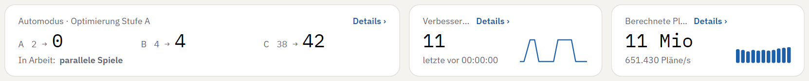

### 5.3 Die Generierung steuern

| Schaltfläche | Wirkung |
|---|---|
| **▶ Start** | Beginnt die Suche mit dem Ausgangsplan aus **Start mit** und dem gewählten Verfahren. |
| **Verfahren** | Wählt das Verfahren für den nächsten Start; während der Generierung wechselt ein Klick zum anderen Verfahren, ab dem bisher besten Plan. |
| **⏸ Pausieren** / **▮▶ Fortsetzen** (statt ▶ Start während der Generierung) | Hält die Suche an. Der beste Plan bleibt erhalten; so können Sie ihn in Ruhe ansehen oder exportieren. |
| **Fortsetzen** | Setzt eine pausierte Suche mit ihrem besten Plan fort. |
| **■ Stopp** (statt ✕ während der Generierung) | Beendet die Generierung. Ihr bester Plan bleibt erhalten (*bester Plan der letzten Generierung*); danach kann mit einem anderen Ausgangsplan neu gestartet werden. |
| **✕ Staffel schließen** (neben ▶ Start, solange keine Generierung läuft) | Schließt die Staffel (eine laufende Generierung wird beendet) und führt zur Startseite. |

**Start mit** legt fest, wovon die nächste Generierung ausgeht:

- **leerem Plan** – das Programm plant von Grund auf neu (Standard);
- **bestem Plan der letzten Generierung** – nach *Stopp* dort weitermachen;
- **gesichertem Plan** – der automatisch gesicherte Plan (siehe unten);
- **in click-TT vorhandenem Plan** – ein schon in click-TT eingetragener Plan wird verbessert;
- **gemerktem Plan „…“** – ein früher gemerkter Plan (Abschnitt [5.11](#511-pläne-merken-und-vergleichen)).

Solange eine Generierung läuft oder pausiert ist, ist *Start mit* gesperrt: Eine laufende Generierung setzt immer ihren eigenen besten Plan fort. Für einen anderen Ausgangsplan zuerst **Stopp**.

**Gesicherter Plan.** Je Staffel gibt es einen gesicherten Plan. Würde der aktuelle Plan verworfen – weil eine neue Generierung startet, die Staffel geschlossen, eine andere geöffnet oder das Programm beendet wird –, sichert das Programm ihn vorher: Gibt es noch keinen gesicherten Plan, geschieht das automatisch, und eine Meldung sagt es. Gibt es schon einen und hat er dieselben Begegnungen an denselben Tagen, meldet das Programm nur, dass beide identisch sind. Sonst fragt es, ob er durch den aktuellen ersetzt werden soll, und zeigt dazu beide nebeneinander: die Verstöße der Stufen A (mit den harten Fehlern), B und C, die Kosten und die einzelnen Kriterien, bei denen sie sich unterscheiden; der jeweils bessere Wert ist grün, und darunter steht, welcher Plan insgesamt besser ist (erst A, dann B, dann C, zuletzt die Kosten). Im Kompaktmodus vergleicht der Dialog stattdessen die Kennzahlen der Kompaktspieltage (Abschnitt [6.10](#610-pläne-sichern-und-merken)). Sie wählen **Aktuellen Plan sichern**, **Gesicherten Plan behalten** oder **Abbrechen** (dann unterbleibt der Neustart bzw. das Schließen). Der gesicherte Plan steht wie ein gemerkter unter **Start mit** und in der Planauswahl der Ansichten. Das Original kennt keine solche Sicherung; dort geht ein nicht gemerkter Plan beim Schließen verloren.

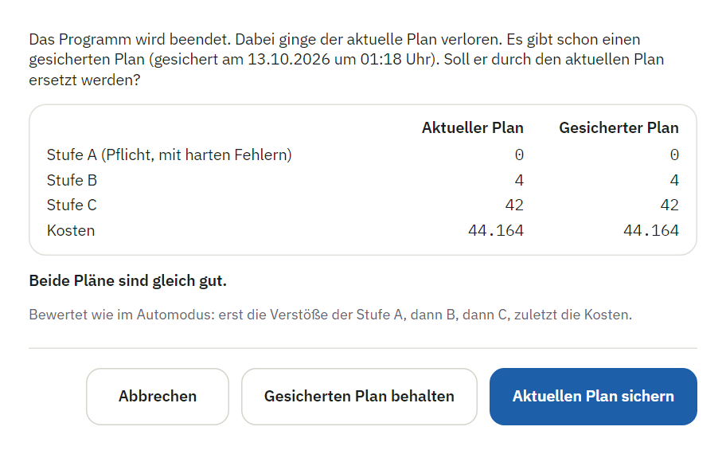

Änderungen an den **Einstellungen** und **Spielplandaten** übernimmt eine laufende Generierung sofort; sie rechnet vom bisher besten Plan aus weiter.

### 5.4 Der Automodus

Bei der **Kostenoptimierung** sucht das Programm den Plan mit den niedrigsten Gesamtkosten; was dabei wie viel zählt, bestimmen Sie über die Gewichtungen (Abschnitt [5.10](#510-gewichtungen-anpassen)). Oft dreht man dann von Hand nach: Ein Kriterium hat noch Verstöße, also Gewicht hoch, abwarten, nächstes Kriterium. Genau das übernimmt der **Automodus**. Er verändert die Gewichte selbst und richtet sich dabei nach der Einteilung der Kriterien in die Stufen A, B und C, die Sie in der Ansicht **Qualität** festlegen (Abschnitt [5.8](#58-qualität)). Ihre eigenen Gewichtungen bleiben dabei unverändert.

Der Automodus arbeitet in **Phasen**; die laufende steht oben in der Ergebniskachel:

1. **Basisoptimierung** – eine gewöhnliche Kostenoptimierung mit Ihren Gewichtungen, bis sie nicht mehr deutlich vorankommt: Gezählt werden nur Verbesserungen um mindestens 1 % der Kosten; bleiben sie mindestens 10 Sekunden und 500.000 berechnete Pläne lang aus, geht es weiter (ein langsamer Rechner sucht dafür entsprechend länger). Spätestens nach 3 Minuten beginnt in jedem Fall Stufe A. Ihr bester Plan ist der Maßstab für alles Weitere (in der Kachel die kleine Zahl vor dem Pfeil, z. B. „A 14 → 3“).
2. **Optimierung Stufe A** – direkt nach der Basisoptimierung hebt der Automodus ein erstes Mal an. Danach beobachtet er die Verstöße der Stufe A. Ändern sie sich mindestens 10 Sekunden und 500.000 berechnete Pläne lang nicht mehr, hebt er das Gewicht genau der Mannschaften und Kriterien um eine Stufe an, die noch Verstöße haben. Das wiederholt er, bis keine Verstöße mehr übrig sind, nichts mehr anzuheben ist oder es dreimal hintereinander nicht besser wird.
3. **Optimierung Stufe B** – geht bei A nichts mehr, schützt der Automodus A (Gewichte „extrem hoch“) und sucht B nicht mit angehobenen Gewichten, sondern zählend: Die Inseln vergleichen Pläne wie der Automodus – erst Spiele ohne gültigen Termin, dann A, dann B, dann C – und machen A und B nie schlechter als im besten Plan. Mit angehobenen B-Gewichten liefen sie sonst vom besten Plan weg, bis zu Plänen mit Spielen ohne Termin.
4. **Optimierung Stufe C** – nun glättet er die übrigen Kriterien der Reihe nach, wie sie in der Einteilung stehen, ausgehend vom besten Plan. Zuerst nimmt er sich Ausreißer vor: Mannschaften, die bei einem Kriterium mehr als zwei Verstöße mehr haben als nach der Basisoptimierung – ein, zwei mehr sind in Ordnung, viele bei einer Mannschaft wären unfair. Steigen dabei die Verstöße in A oder B wieder, nimmt er die letzte Anhebung zurück und macht beim nächsten Kriterium weiter. Sind alle Kriterien der Stufe C durch, beginnt er wieder mit dem Herausdrängen.

**HiGHS rechnet mit.** Ist der Löser HiGHS verfügbar, berechnet er ab dem Start nebenher den Plan, der in den Stufen A und B **bestmöglich** ist – erst so wenige A-Verstöße wie möglich, dann so wenige B-Verstöße wie möglich, wie der Automodus innerhalb einer Stufe jeden Verstoß gleich zählt –, und beweist, wie viele Verstöße jeder Plan dort mindestens hat (die Kopfzeilen der Stufen und die Spalte *Untergrenze* der Ansicht **Qualität**, Abschnitt [5.8](#58-qualität)). HiGHS hat dabei **Vorrang**: Von den Rechen-Threads der Inseln ruhen so viele, wie HiGHS gerade Rechnungen laufen hat (je Rechnung ein Kern, höchstens die Hälfte – die andere Hälfte sucht immer weiter); rechnet HiGHS nicht, rechnen alle. Beides geht in den laufenden Automodus ein:

- **Die Schranke** sagt, wann bei einer Stufe nichts mehr zu holen ist. Erreicht der beste Plan sie in Stufe A, hört der Automodus dort sofort auf zu drängen (statt drei vergebliche Versuche abzuwarten), setzt die Gewichte der Stufe A auf „extrem hoch“, damit die Suche sie hält, und macht mit B weiter; ebenso von B nach C. Sind A und B bestmöglich, wird nach dem Glätten von C nicht wieder gedrängt, sondern von vorn geglättet. Die Schranke von A geht gleich nach Stufe A an den Automodus (nicht erst nach Stufe B). Hat der beste Plan sie, drängt er B nicht mehr mit angehobenen Gewichten, sondern sucht gleich zählend wie beim Glätten: erst B, dann C, A und B nie schlechter als im besten Plan – mit angehobenen Gewichten liefen die Inseln vom besten Plan weg (bis A 19 bis 23, während er A 10 hatte).
- **Der Plan aus HiGHS** beendet die Basisoptimierung, sobald er vorliegt (ihr bisher bester Plan ist der Maßstab für C), und wird sofort geprüft: Ist er besser, wird er bester Plan und gleich angezeigt, und die Hälfte der Inseln rechnet von ihm aus weiter; die andere Hälfte sucht mit ihren eigenen Plänen weiter – so bleibt die Suche vielfältig. Zwischenpläne (nach jedem Schritt der Untergrenze, etwa der in A bestmögliche Plan, und mitten in einem Schritt jeder bessere Plan, den HiGHS findet – höchstens alle 2 Sekunden) bietet HiGHS sofort an; kommen sie während der Basisoptimierung, prüft der Automodus den neuesten an ihrem Ende. Ist Stufe A bewiesen und ihr Plan da, endet die Basisoptimierung gleich (frühestens nach 10 s) – sie brächte A nicht weiter. Ab 8 logischen Prozessoren rechnet HiGHS die Summe B schon gleich nach Stufe A mit, neben den B-Kriterien einzeln und den Varianten; ihre Pläne gehen ebenso sofort an den Automodus.

- **Teilneuplanung:** Sobald die Untergrenze Stufe A fertig hat (vorher hat HiGHS dort Vorrang), plant HiGHS fortlaufend einen Ausschnitt des besten Plans neu und hält den Rest fest: die Spiele zweier zufälliger Mannschaften, der zwei Mannschaften mit den meisten C-Verstößen oder aller Spiele eines Zeitfensters von einigen Wochen – Art und Größe, die zuletzt je Sekunde die meisten C-Verstöße eingespart haben, kommen öfter dran. Beim Glätten von C rechnen mehrere Teilneuplanungen gleichzeitig an möglichst verschiedenen Mannschaften (höchstens auf der Hälfte der Kerne, die Inseln geben sie ab); verbessern die Inseln je Rechen-Thread deutlich mehr, werden es weniger, sonst wieder mehr. Ist der beste Plan inzwischen ein anderer, rechnet HiGHS einen erfolgversprechenden Ausschnitt am neuen Plan nach. A und B dürfen dabei nicht schlechter werden; HiGHS senkt erst die Summe der B-Verstöße (ein B-Verstoß zählt im Ziel so viel wie 20 C-Verstöße), dann C – so wird auch B nach den Varianten noch besser. HiGHS zählt C dabei fast wie die Bewertung – Wechsel Heim/Auswärts, die 60-km-Regel, zu lange und überlappende Spieltage und die Pausen der Spielverteilung genau (die Pausen bei Koppelterminen genähert), Abstand Heim/Auswärts und – wenn es eine gibt – die Setzliste genähert: Genau gezählt würden sie die Ausschnitte für HiGHS so schwer machen, dass es weniger fände. Jeder Ausschnitt, der danach nach den Regeln des Automodus besser ist (auch ohne neue Ausreißer in C), wird **sofort** bester Plan, und die schlechteste Insel rechnet von ihm aus weiter. Finden die Inseln inzwischen einen besseren Plan, plant HiGHS ab dem nächsten Ausschnitt von diesem aus weiter – es gibt also immer nur einen besten Plan, an dem Inseln und HiGHS gemeinsam arbeiten. Auch die untere Schranke bietet nach jedem ihrer Schritte ihren Plan sofort an; wird er bester Plan, beginnen alle Inseln, die in A oder B schlechter sind, sofort mit ihm (statt noch lange an ihren alten Plänen weiterzurechnen), und der Automodus schützt A und B gleich (Gewichte „extrem hoch“) und glättet C vom besten Plan aus. Macht eine Anhebung beim Glätten die Suche in A oder B schlechter, zieht der Automodus sie gleich zurück, und die Inseln beginnen wieder beim besten Plan – so rechnen sie nicht lange an Plänen, die nie bester Plan werden können. Beim Glätten von C vergleichen die Inseln Pläne außerdem genau wie der Automodus: erst die Verstöße in A, dann in B, dann die Zahl der C-Verstöße (mit den Pausen der Spielverteilung und den Spieltagen); die Kosten entscheiden nur bei Gleichstand. Und sie suchen dann mit **später Annahme** (Late Acceptance): Jeder Suchplatz nimmt einen neuen Plan auch an, wenn er in C nicht schlechter ist als sein Plan vor 1000 Schritten – so kommt er über Kämme, an denen die reine Verbesserungssuche des Originals feststeckt. A und B dürfen dabei nie schlechter werden als im besten Plan; jeder Platz geht seinen eigenen Weg, die Insel merkt sich den besten. So durchsucht die Inselsuche C anders als die Teilneuplanung (ganze Saison in kleinen Schritten statt einzelner Ausschnitte genau) – in der Bezirksliga Süd verbesserten die Inseln den besten Plan in 10 Minuten rund 47-mal statt 15-mal. Im Leitstand steht das im Schaubild rechts (Abschnitt [5.5](#55-der-leitstand)).

- **HiGHS-Linien:** Von Anfang an – schon während der Basisoptimierung – rechnen ab 8 logischen Prozessoren eine, ab 12 zwei lange HiGHS-Läufe für A und B zusammen, ohne erst A zu beweisen (ein A-Verstoß zählt dabei wie 100 B-Verstöße), jede mit eigenem Startwert. Jeder bessere Plan geht sofort an den Automodus. Je Linie verfeinern zwei Teilneuplanungen ihre Pläne – auch solche aus einer anderen Gegend, die noch nicht der beste Plan sind; oft wird gerade daraus der beste. Nach 20 Minuten beginnt eine Linie mit neuem Startwert an ihrem besten Plan; hat HiGHS den Plan als bestmöglich bewiesen (kleine Staffeln), endet sie. Im Vergleich an der Verbandsoberliga (nur HiGHS, 5 Minuten) kam das auf B 24 statt 33 bis 37 mit einem oder vielen Läufen allein; in einer schwereren Einteilung auf B 34 statt 52 bis 66.

So nähern sich beide von zwei Seiten: HiGHS sagt, wo unten Schluss ist; die Suche kommt von oben.

Der Automodus hat keine Zeitgrenze; er läuft, bis Sie **Pausieren** oder **Stopp** wählen. Unter **In Arbeit** zeigt die Ergebniskachel, an welchen Kriterien er gerade arbeitet (Abschnitt [5.2](#52-die-kacheln)).

**Welcher Plan ist der beste?** Der Automodus vergleicht Pläne nicht nach den Gesamtkosten, sondern der Reihe nach: harte Fehler, Verstöße der Stufe A, Verstöße der Stufe B, Verstöße in C, dann Ausreißer in C und erst zuletzt die Kosten mit Ihren Gewichtungen. Bei gleichem A und B hat ein besserer Plan also nie mehr Verstöße in C – egal, ob er von einer Insel oder von HiGHS kommt: Beide werden vor der Übernahme gleich bewertet, mit der vollständigen Bewertung (nicht mit der Näherung, mit der HiGHS rechnet). Ein Plan mit weniger Verstößen in A gewinnt also immer, auch wenn er teurer ist.

**Eingreifen während der Generierung:**

- **Einteilung ändern** – verschieben Sie in der Ansicht **Qualität** ein Kriterium, gilt das sofort, ohne neue Basisoptimierung. Rückt etwa ein Kriterium von B1 nach A2, drängt der Automodus zuerst genau dieses Kriterium heraus und danach wieder die ganze Stufe A. Das verschobene Kriterium steht danach einige Sekunden vorn unter **In Arbeit** – auch wenn der Automodus schon weiter ist, weil es dort gerade nichts zu verbessern gab.
- **Verfahren wechseln** – unter **Verfahren**, auch in der Pause. Beim Wechsel von der Kostenoptimierung in den Automodus entfällt die Basisoptimierung: Der bisher beste Plan ist schon optimiert und gilt als Basis, der Automodus beginnt sofort mit Stufe A. Ein bewährter Weg ist deshalb, mit der Kostenoptimierung zu beginnen und, wenn sie kaum noch Fortschritte macht, in den Automodus zu wechseln.

**Wann welches Verfahren?** Der Automodus lohnt sich, wenn Pflichtregeln und Terminwünsche der Vereine Vorrang haben und Sie nicht selbst an den Gewichten drehen wollen. Die Kostenoptimierung ist die richtige Wahl, wenn Sie die Gewichtungen gezielt einsetzen oder Ergebnisse mit dem alten AndiGenerator vergleichen wollen – sie rechnet wie das Original.

### 5.5 Der Leitstand

Der Leitstand zeigt, was beim Rechnen geschieht. Sie öffnen ihn mit **Details ›** in der Kachel *Berechnete Pläne*. Für die Planung selbst brauchen Sie ihn nicht; er hilft aber zu verstehen, warum es gerade vorangeht oder nicht. Das Bild bleibt ruhig und bewegt sich nur, wenn etwas geschieht.

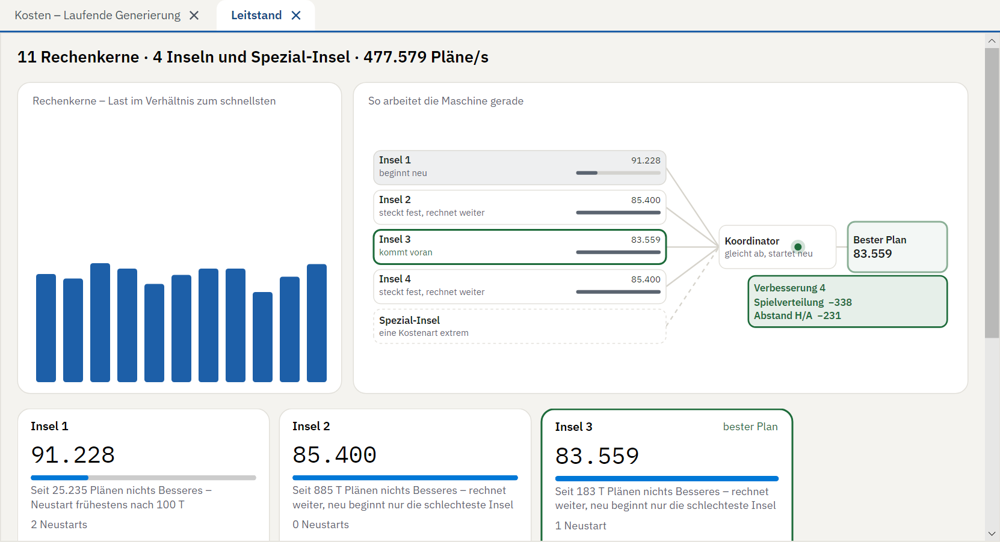

Von oben nach unten:

- **Prozessor** (oben links): wie stark der ganze Prozessor ausgelastet ist (z. B. „93 % ausgelastet“) und als Leiste, in der je Kern eine dünne Linie steht – so sehen Sie auch, wie viele Kerne arbeiten. Blau ist die Suche, orange HiGHS, grau der Rest des Programms, hell frei. Darunter dieselben Teile in Kernen („Suche 10,2 Kerne“, „HiGHS 1,0 Kern“). HiGHS hat keinen eigenen Kern: Es rechnet auf einem eigenen Faden und teilt sich den Prozessor mit der Suche. Ganz unten der **Verlauf der letzten 2 Minuten** als gestapelte Fläche, ebenfalls mit einer Linie je Kern: Dort ist zu sehen, wann HiGHS rechnet und wie viel es der Suche abnimmt. Gemessen wird die Rechenzeit je Faden (Windows und Linux).
- **Schaubild der Maschine** (oben rechts): In der Mitte steht der **beste Plan**, links liefern die **Inseln** Pläne, rechts – wenn es rechnet – **HiGHS**. Über dem besten Plan steht der Kasten, der die Pläne vergleicht und die Suche lenkt: bei der Kostenoptimierung der *Koordinator*, im Automodus der *Automodus* mit dem, woran er gerade arbeitet („Stufe C: 3-Tage-Abstand“); die gestrichelte Linie zu den Inseln steht dafür, dass er ihre Gewichte ändert und sie neu startet. Gerechnet wird in den Inseln, jeweils an vielen **Suchplätzen**, die bei jedem Schritt einen Teil der Spiele neu verteilen; die Rechenkerne rechnen reihum an allen. Wird der beste Plan besser, wandert ein Punkt von seiner Herkunft zu *Bester Plan* – **grün** von einer Insel, **orange** von HiGHS –, und der leuchtet kurz auf. Im Automodus steht im besten Plan, woher er zuletzt kam und wie viele Verbesserungen von den Inseln und von HiGHS stammen („Inseln 23 · HiGHS 8“).
- **Kasten unter dem besten Plan:** Bei jeder Verbesserung (grüner Punkt von einer Insel, oranger von HiGHS) erscheint bzw. aktualisiert sich ein Kasten mit der Nummer der Verbesserung – dieselbe Zahl wie in der Kachel *Verbesserungen*, z. B. „Verbesserung 57“ – und dem, was sich geändert hat. Oft wird ein Kriterium besser und ein anderes dafür etwas schlechter. Bei der Kostenoptimierung stehen dort die Kriterien mit den größten Kostendifferenzen (grün mit „−“ besser, rot mit „+“ schlechter), im Automodus die Änderungen der Verstöße, wichtigste Stufe zuerst (z. B. „A · Hallenbelegung 2 → 1“). Ändert sich kein Kriterium sichtbar, steht dort *Feinschliff*. 10 Sekunden nach der letzten Verbesserung verschwindet der Kasten.
- **Inseln:** Jede Insel sucht für sich und hat ihren eigenen besten Plan. Ihre Karte zeigt den Wert dieses Plans (Kosten, im Automodus die Verstöße A · B · C), was sie gerade tut (Tabelle unten) und einen Balken: Er zeigt, wie lange sie schon nichts Besseres gefunden hat, gemessen an der Neustart-Grenze (100 T Pläne). Darunter stehen die drei größten Kostenverursacher ihres Plans mit ihrem Anteil an den Kosten; im Automodus alle Kriterien der Stufen A und B mit Verstößen, je mit ihrer Stufe („A · parallele Spiele 20“), dazu die zwei Kriterien der Stufe C mit den meisten. Hat der Plan einer Insel Spiele ohne gültigen Termin, steht das rot auf ihrer Karte („3 Spiele ohne gültigen Termin – so nicht verwendbar“) und im Schaubild „ungültig“ vor ihren Werten: Ein solcher Plan kann in A weniger Verstöße haben als jeder gültige. Die Insel mit dem besten Plan ist grün umrandet.

| Die Insel … | Bedeutung |
|---|---|
| *kommt voran* | Sie hat in den letzten 5 Sekunden einen besseren Plan gefunden. |
| *sucht* | Sie rechnet; ihr Balken ist noch nicht weit gefüllt. |
| *findet lange nichts* | Ihr Balken ist über 60 % gefüllt. |
| *steckt fest, rechnet weiter* | Ihr Balken ist voll, ihr Plan ist aber besser als der schlechteste – sie rechnet weiter. |
| *beginnt gleich neu* | Ihr Balken ist voll, und sie hat den schlechtesten Plan aller Inseln – sie wird als nächste neu begonnen, auch wenn sie eben noch verbessert hat. Bei vielen Plänen je Sekunde ist die Grenze schnell wieder erreicht. |
| *beginnt neu* | Sie wird gerade mit einem neuen Plan begonnen (kurz grau). |

Neu beginnt also nur die **schlechteste** Insel, und erst wenn ihr Balken voll ist – höchstens eine je Sekunde. Im **Automodus** (nach der Basisoptimierung) beginnt die schlechteste der Inseln mit vollem Balken neu – bei Gleichstand die, die am längsten feststeckt –, so dass keine Insel dauerhaft feststeckt. Beim Glätten mit später Annahme beginnt sie reihum mit dem *besten Plan mit Stoß* (einige Suchschritte am besten Plan, die A und B nicht verschlechtern; kein Spiel bleibt ohne Termin), einem Plan *aus der Teilneuplanung* (einem, den HiGHS im Modell für besser hielt, die Bewertung aber nicht) dem *besten Plan* selbst oder einem *anderen guten Plan*: einem Plan, der nicht bester Plan wurde (aus einer HiGHS-Linie, einer B-Variante, einem Zwischenplan der Untergrenze oder der Teilneuplanung), in A so gut wie der beste und in B höchstens ein Zehntel schlechter. Steht schon eine andere Insel beim besten Plan, nimmt eine Insel statt einer weiteren Kopie von ihm einen anderen guten Plan (gibt es keinen, den besten Plan mit Stoß) – so suchen die Inseln nahe am besten Plan, aber nicht alle an derselben Stelle. Ohne späte Annahme (in Stufe A und B) beginnt sie reihum mit einem anderen **Startverfahren**: meist mit dem besten Plan, in dem nur ein kleiner Teil seinen Termin verliert und von der Insel neu geplant wird – *einige Spiele neu*, *eine Woche neu* oder *eine Mannschaft neu* –, oft mit einem Plan aus der Teilneuplanung und nur jedes achte Mal mit einem *leeren Plan*. Ebenso beginnt eine Insel neu, die nach dem Dreifachen der Neustart-Grenze in A oder B noch immer schlechter ist als der beste Plan. Die Karte zeigt beim Neustart, womit die Insel beginnt (z. B. „beginnt neu: bester Plan“). `andigen optimieren` nennt am Ende je Startverfahren die Neustarts und wie oft eine so begonnene Insel danach den besten Plan verbessert hat. Bei der Kostenoptimierung kommt die **Spezial-Insel** hinzu: Sie gewichtet eine Kostenart extrem hoch und gibt gute Pläne an die anderen Inseln weiter.

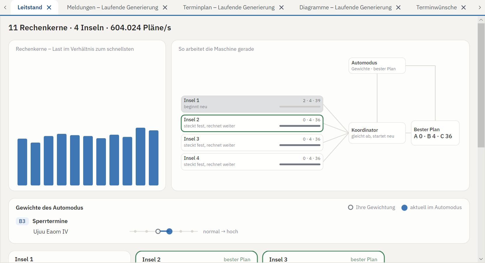

Im **Automodus** steuert der Kasten *Automodus* im Schaubild die Suche: Er hebt die Gewichte an und wählt den besten Plan nach A, B und C aus (Abschnitt [5.4](#54-der-automodus)). Oberhalb der Inseln steht dann, welche **Gewichte** der Automodus gegenüber Ihren angehoben hat – je Kriterium und Mannschaft auf einer Skala von „sehr wenig“ bis „extrem hoch“: Der Ring ist Ihre Gewichtung, der blaue Punkt die aktuelle des Automodus, die blaue Linie der Weg dazwischen. Darunter stehen die **letzten Schritte** des Automodus (angehoben, zurückgezogen).

Rechnet **HiGHS** nebenher, steht im Schaubild rechts sein orangefarbener Kasten, verbunden mit dem besten Plan: für die *untere Schranke* Schritt und Kriterium mit einem Balken, für die *Teilneuplanung* je neu geplantem Ausschnitt ein Kästchen (grün besser, rot im Modell besser, nach der echten Bewertung aber nicht, grau nichts Besseres, blau Plan der Inseln übernommen; umrandet der, den HiGHS gerade plant), wie viele Mannschaften gerade neu geplant werden, ihr Plan (A · B · C), wie viele Ausschnitte besser waren und wie oft ihr Plan bester Plan geworden ist bzw. sie den Plan der Inseln übernommen hat (dann wandert ein blauer Punkt vom besten Plan zu HiGHS). Unter *Erfolg je Größe des Ausschnitts* steht je Größe (2, 3, … Mannschaften) ein Balken mit dem Anteil der besseren Ausschnitte, rechts angenommen/geplant und die Sekunden je Ausschnitt – so ist zu sehen, welche Größe gerade etwas bringt. Wie viel Prozessor HiGHS braucht, zeigt die Anzeige *Prozessor* links. Unten im Leitstand erklärt ein Text, wie Inseln und HiGHS zusammenarbeiten. Kennt der Automodus die Schranke, steht unter *Gewichte des Automodus* die **untere Schranke** je Stufe neben dem Wert des besten Plans („A ≥ 9 (bester Plan 9 – bestmöglich)“). Ändert der Automodus dasselbe Gewicht bei vielen Mannschaften – etwa wenn er eine bestmögliche Stufe schützt –, steht das in einer Zeile („10 Mannschaften“).

### 5.6 Der Verlauf

Die Ansicht **Verlauf** öffnen Sie mit **Details ›** in der Kachel *Verbesserungen*. Sie zeigt formatfüllend, wie sich der beste Plan seit dem Start entwickelt hat – im Automodus je Stufe eine Spur (A, B, C, jede mit eigener Skala), bei der Kostenoptimierung eine Spur für die Kosten. Der beste Plan steht als **Treppe** da, denn er verbessert sich sprunghaft; jede Verbesserung ist ein **Punkt** in der Farbe ihrer Herkunft: blau die Inseln, orange HiGHS, violett die Teilneuplanung. Große Sprünge aus HiGHS sind beschriftet, etwa „35 → 10“. Kennt HiGHS die **Grenze** einer Stufe, steht sie gestrichelt in der Spur: grün mit „Optimum erreicht“, wenn der Plan sie erreicht, sonst orange mit einer schraffierten Fläche – so viel ist dort höchstens noch zu holen. Fähnchen über den Spuren markieren die **Meilensteine** (Basisoptimierung fertig, A bzw. B bestmöglich, Festlegung einer B-Variante und ihr Aufheben); die Zeit der Basisoptimierung ist grau hinterlegt, kleine blaue Striche unter der letzten Spur zeigen, wann der Automodus Gewichte angehoben hat. Links steht je Spur der aktuelle Wert mit dem Weg seit dem Start („Start 62 · −84 %“) und „✓ bestmöglich“ bzw. das Ziel, rechts, wie viele Verbesserungen dieser Stufe von wem kamen. Ganz unten zeigt **Wer rechnet**, wie sich der Prozessor auf die Suche, HiGHS und den Rest verteilt. Fahren Sie mit der Maus über das Diagramm, zeigt ein Kästchen in der Nähe einer Verbesserung, woher sie kam und was sie geändert hat (grün besser, rot schlechter), sonst die Werte zu diesem Zeitpunkt.

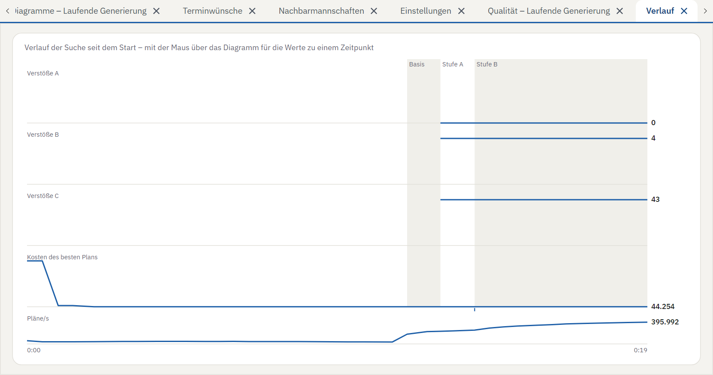

Am Verlauf sehen Sie, ob sich weiteres Rechnen noch lohnt: Wird die Kurve flach, findet das Programm nur noch selten etwas Besseres.

### 5.7 Kosten

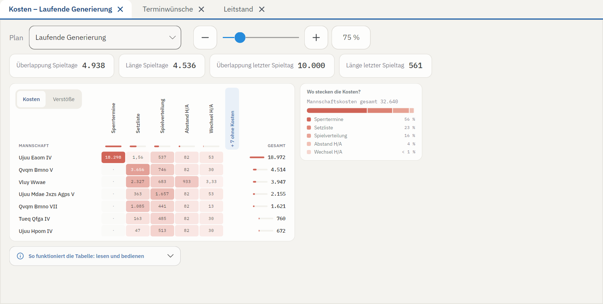

Die Kostenansicht ist das wichtigste Werkzeug während der Generierung. Das Programm bewertet jeden Plan mit **Kosten** (Strafpunkten): Jeder verletzte Wunsch, jede ungünstige Konstellation kostet etwas. Gesucht wird der Plan mit den geringsten Gesamtkosten. Was die einzelnen Kostenarten bedeuten, steht in Abschnitt [5.13](#513-bewertung-der-pläne-kosten).

Wie alle Ansichten, die einen Plan zeigen, wählt die Kostenansicht oben unter **Plan**, welchen: den besten Plan der laufenden Generierung, den in click-TT vorhandenen Plan oder einen gemerkten Plan. So lassen sich Pläne nebeneinander vergleichen – etwa zwei Kostenansichten mit verschiedenen Plänen.

- **Kennzahlen:** Unter der Leiste stehen die Kosten, die den ganzen Plan betreffen (Überlappung und Länge der Spieltage, Überlappung und Länge des letzten Spieltags, vereinsinterne Spiele am Anfang). Die Gesamtkosten erscheinen hier nur, wenn Sie einen anderen Plan als die laufende Generierung gewählt haben – die laufende steht ja schon oben in der Kachel.
- **Kostenmatrix:** Zeilen sind die Mannschaften, Spalten die Kostenarten. Beide sind nach Kosten sortiert; die teuersten stehen links oben. Je röter eine Zelle, desto größer ihr Anteil an den Gesamtkosten – dort lohnt es sich zuerst hinzuschauen. Rechts steht die Summe je Mannschaft.
- **Kosten / Verstöße:** Der Umschalter links oben in der Matrix wechselt zwischen den Kostenpunkten und der Zahl der Verstöße. `2/178` heißt: 2 von 178 möglichen Fällen verletzt, zum Beispiel 2 der 178 gemeldeten Sperrtermine belegt. `·` heißt eingehalten; `–` heißt, diese Kostenart zählt keine Verstöße, nur Kostenpunkte (zum Beispiel die Spielverteilung). T steht für Tausend, Mio für Millionen.
- **Leere Kostenarten:** Kostenarten ohne Kosten sind ausgeblendet. Die schmale blaue Spalte **+ n ohne Kosten** blendet sie ein (als schmale graue Spalten) und wieder aus.
- **Wo stecken die Kosten?** Die Karte neben der Matrix zeigt den Anteil jeder Kostenart an den Mannschaftskosten als Balken und Liste.
- **Marken:** Blaue Marken wie **+1** bis **+3** (wichtiger), **−1**, **−2** (weniger wichtig) oder **X** (nicht berücksichtigt) zeigen eine geänderte Gewichtung. Ein blauer Punkt in einer Zelle bedeutet, dass genau diese Zelle eine eigene Gewichtung hat.

**Klicken zeigt Details:** Ein Klick auf eine Zelle, eine Kostenart (Spaltenkopf), eine Mannschaft (Name) oder eine Kennzahl öffnet rechts ein Detailfeld. Es zeigt Verstöße, Kosten und Anteil, die Meldungen dazu (was genau verletzt ist) und die **Gewichtung**, die Sie dort direkt ändern können (Abschnitt [5.10](#510-gewichtungen-anpassen)). Mit **×** schließen Sie das Detailfeld wieder.

Die aufklappbare Hilfe **So funktioniert die Tabelle** unter der Matrix fasst das alles kurz zusammen.

### 5.8 Qualität

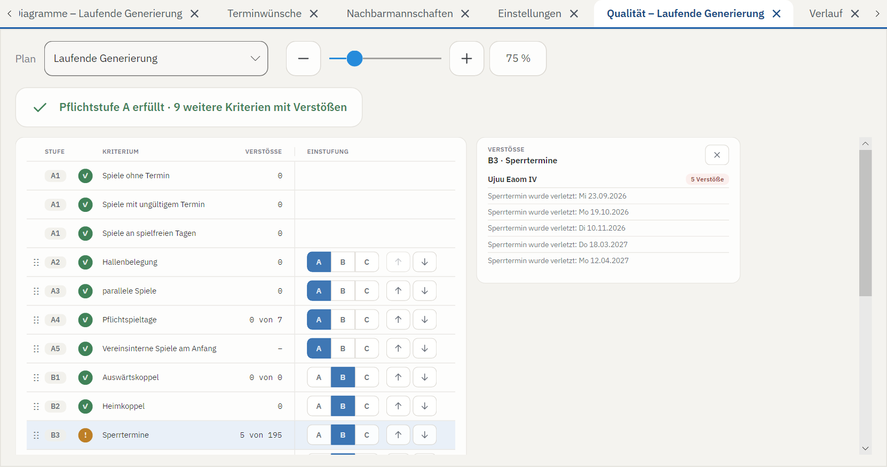

Die Kosten sagen, wie gut ein Plan *insgesamt* ist. Die Qualitätsansicht beantwortet eine andere Frage: **Welche Regeln verletzt der Plan, und wie oft?** Die Kriterien sind nach Wichtigkeit in drei Stufen geordnet. Voreingestellt ist:

| Stufe | Kriterien | Ziel |
|---|---|---|
| **A – Pflicht** | A1 alle Spiele terminiert, gültig und nicht an spielfreien Tagen · A2 vereinsinterne Spiele am Anfang (die Wettspielordnung setzt sie voraus) · A3 Hallenbelegung · A4 parallele Spiele · A5 Pflichtspieltage | einhalten |
| **B – Wünsche** | B1 Auswärtskoppel · B2 Heimkoppel · B3 Sperrtermine · B4 Ausweichtermine | möglichst wenige Verstöße; bei sehr vielen gemeldeten Sperrterminen ist ein Rest vertretbar |
| **C – Güte** | alle übrigen Kostenarten, z. B. Heim/Auswärts ausgeglichen, Wechsel Heim/Auswärts, 3-Tage-Abstand, zuletzt die Spieltage | so gut wie möglich |

**Verstöße im Einzelnen:** Ein Klick auf eine Zeile zeigt rechts daneben – immer oben im Blick, auch wenn die Tabelle heruntergescrollt ist –, wo das Kriterium verletzt ist – je Mannschaft, die meisten Verstöße zuerst, mit den Meldungen wie in der Ansicht **Meldungen** (bei A1 die harten Fehler des ganzen Plans). Ein zweiter Klick auf die Zeile oder **×** schließt die Liste. Hat das Kriterium keine Verstöße, bleibt sie zu; die Liste folgt dem Plan, auch während die Generierung läuft. Bei den vereinsinternen Spielen am Anfang stehen je Mannschaft die Spiele gegen fremde Vereine, die vor einem vereinsinternen Spiel liegen – gezählt wird jedes davon, so sehen Sie, welche Paarung verlegt werden müsste. Für die Kriterien, die im Original nur Kosten haben, zählt das Programm selbst (nicht im Original): bei der **Spielverteilung** die Pausen einer Mannschaft, in denen im Mittel mindestens zwei Spieltage liegen (normal ist einer), bei **Länge Spieltage** die Spieltage (die n-ten Spiele aller Mannschaften), die – auf 10 Mannschaften bezogen – länger als 6 Tage dauern, bei **Überlappung Spieltage** die Spieltage, die beginnen, bevor ein früherer zu Ende ist, beim **letzten Spieltag** 0 oder 1. Ein Klick zeigt die Pausen je Mannschaft bzw. die Spieltage mit ihren Daten. Diese Anzahlen gehen in die C-Verstöße des Automodus ein; die Kostentabelle bleibt wie im Original.

**Die Einteilung bestimmen Sie selbst (im Automodus):** Rechts in jeder Zeile wählen Sie die Stufe **A**, **B** oder **C** und verschieben das Kriterium mit den Pfeilen nach oben (wichtiger) oder unten. Rückt ein Kriterium in eine weniger wichtige Stufe (A → B, B → C), steht es dort an erster Stelle; rückt es in eine wichtigere (C → B, B → A), kommt es ans Ende. Am Rand einer Stufe führen die Pfeile in die Nachbarstufe. Oder Sie ziehen die Zeile am Griff **⋮⋮** links an die gewünschte Stelle: Die Zeile hängt dann am Mauszeiger, und die Tabelle macht dort Platz, wo sie landen würde, und nummeriert schon um – Stufe und Nummer ergeben sich aus der Stelle. **Esc** bricht das Ziehen ab. Bei der Kostenoptimierung ist die Einteilung nur zu sehen, nicht zu ändern. Die Nummern folgen der Reihenfolge. Nur A1 (harte Fehler) ist fest, und Länge und Überlappung der Spieltage bleiben in C, weil sie keine Anzahl von Verstößen haben. Ebenso bleibt ein Kriterium in C, das HiGHS für diese Staffel nicht kennt (zum Beispiel Abstand Heim/Auswärts bei einer Doppelrunde): In A oder B gäbe es dafür weder Grenze noch Varianten – die Knöpfe A und B sagen das, und beim Ziehen steht der Grund an der Zeile, die Lücke bleibt in C. Bei Hin- und Rückrunde kennt HiGHS alle Kriterien. Die Einteilung wird mit den Spielplandaten gespeichert (bei click-TT-Dateien in der `.modifications`; der alte AndiGenerator lädt die Datei weiterhin und lässt die Angabe unbeachtet). Der **Automodus** richtet sich nach dieser Einteilung: Er drängt erst die Verstöße der Stufe A, dann B heraus und glättet C in der gewählten Reihenfolge. Eine Änderung während der Generierung gilt sofort, ohne neue Basisoptimierung: Der Automodus behält seine Gewichte und macht sofort beim wichtigsten geänderten Kriterium weiter – schieben Sie etwa B1 nach A2, drängt er zuerst genau dieses Kriterium heraus (solange es dort noch vorangeht), danach wieder die ganze Stufe A; bei einer Änderung in C glättet er ab diesem Kriterium. Liegt die Änderung hinter der Stelle, an der er gerade arbeitet, macht er dort einfach weiter. Zählt die Suche beim Glätten schon die Verstöße, zählt sie gleich nach der neuen Einteilung weiter (erst A, dann B, dann C). In jedem Fall beginnen alle Inseln beim besten Plan neu und vergleichen nach der neuen Einteilung.

**Kann der Plan noch besser werden? (im Automodus):** HiGHS berechnet im Hintergrund, wie viele Verstöße **jeder** Plan mindestens hat – je Stufe zusammengezählt, wie der Automodus vergleicht: zuerst so wenige Spiele ohne Termin wie möglich, dann so wenige A-Verstöße wie möglich (alle Kriterien der Stufe A zusammen), dann bei bestmöglichem A so wenige B-Verstöße wie möglich. Dabei beginnt HiGHS jede Stufe mit dem besten Plan der Generierung: Erreicht er die Grenze schon, ist die Stufe sofort bewiesen, und das Ergebnis von HiGHS ist nie schlechter als er. Solange HiGHS an A und B rechnet, wartet die Teilneuplanung. Eine einmal bewiesene Grenze merkt sich das Programm: Rechnet HiGHS dieselbe Staffel mit denselben Optionen und derselben Einteilung neu, sinkt sie nicht wieder (in seiner Zeit beweist HiGHS nicht immer gleich viel – „mindestens 7“ und „mindestens 8“ stimmen beide, 8 ist nur genauer). Über jeder Stufe steht eine **Kopfzeile** mit den Verstößen des Plans in der Stufe (*Plan 45*), dieser **Grenze** (*Grenze ≥ 11*) und in Klartext, was das heißt:

- **Optimum erreicht – besser geht es nicht** (grün mit Haken): Der Plan hat in der Stufe so wenige Verstöße wie jeder Plan mindestens hat. Weiteres Rechnen bringt dort nichts; die übrigen Verstöße sind unvermeidbar (in Stufe A dann ohne rotes Kreuz).
- **Optimum ist 11: noch 34 Verstöße weniger möglich** (orange): HiGHS kennt einen Plan mit der Grenze – so viel ist sicher noch zu holen.
- **Optimum zwischen 11 und 45: höchstens 34 Verstöße weniger möglich** (orange): HiGHS hat in seiner Zeit nicht bewiesen, wo das Optimum liegt. Die Grenze gilt trotzdem; ob sich die 34 Verstöße wirklich vermeiden lassen, ist offen. Die Leiste daneben zeigt grau, was jeder Plan hat, und orange, was höchstens noch zu vermeiden ist. Ist der beste Plan von HiGHS in dieser Stufe mindestens so gut wie der der Generierung, rechnet HiGHS trotzdem weiter: B-Varianten, A+B und C gelten dann für Pläne, die dort so gut sind wie sein bester Plan. Ist er schlechter, hört die Rechnung dort auf (sonst wären die weiteren Pläne unbrauchbar).
- **Die Grenze gilt erst, wenn A bestmöglich ist** (grau, nur Stufe B): Die Grenze von B wurde bei bestmöglichem A berechnet; mit mehr A-Verstößen könnte B auch besser sein.

Die Zusammenfassung meldet entsprechend **Pflichtstufe A: Optimum erreicht** bzw. **Stufe B: Optimum erreicht**. Die Spalte **Untergrenze** zeigt je Kriterium „nie unter 9“: Weniger Verstöße hat kein Plan bei diesem Kriterium – selbst wenn **nur dieses** Kriterium zählte (in B bei bestmöglichem A). Ob es einen Plan mit genau diesem Wert gibt, ist offen, und zusammen mit den anderen Kriterien der Stufe ist er meist nicht erreichbar; ob der Plan besser werden kann, steht in der Kopfzeile. Ein grüner Haken heißt: Der Plan erreicht die Untergrenze. Ist sie 0, steht dort „kein Verstoß zwingend“: Nichts erzwingt bei diesem Kriterium einen Verstoß. Bei Abstand Heim/Auswärts und Setzliste beweist HiGHS in seiner Zeit meist nur 0 – die Untergrenze sagt dort wenig; was erreichbar ist, zeigen eher die B-Varianten. Steht bei einem Kriterium „HiGHS kennt es nicht“, fehlt es in der Grenze der Stufe (sie gilt trotzdem, ist aber nicht erreichbar, solange der Plan dort Verstöße hat) und in den Varianten.

**B-Varianten:** Hat HiGHS Stufe A bewiesen, rechnet es danach je B-Kriterium eine Variante **Vorrang …**: Das Kriterium hat so wenige Verstöße, wie HiGHS für es allein gefunden hat (A bleibt bestmöglich), die übrigen B-Kriterien danach so wenige wie möglich. Hat HiGHS bewiesen, dass es für das Kriterium allein nicht besser geht, heißt sie **Vorrang … (bestmöglich)**; sonst kann die Untergrenze des Kriteriums darunter liegen – ob ein Plan sie erreicht, ist offen. Dazu kommt der beste Plan für die **Summe in B** (für ihn beginnt HiGHS mit der besten Variante oder dem besten Plan der Generierung): **Plan B optimal**, wenn HiGHS bewiesen hat, dass weniger B-Verstöße zusammen nicht gehen, sonst **Bester Plan für B aus HiGHS** – die Grenze der Stufe ist dann nur eine Untergrenze, ein Plan mit so wenigen Verstößen muss nicht existieren. Kennt HiGHS ein B-Kriterium nicht, gilt beides nur für die übrigen, und der Name nennt sie („Plan B1–B7 optimal“); der Dialog sagt, was fehlt. Liegen Abstand Heim/Auswärts oder Setzliste in B, rechnet HiGHS die Varianten erst ohne sie (dort findet es schnell gute Pläne) und senkt dann von diesen Plänen aus auch Abstand und Setzliste, so weit es in der Zeit kommt – die beiden machen das Modell schwer, HiGHS beweist für sie selten etwas. Bei mehreren B-Kriterien dauert das ein bis zwei Minuten. Varianten, die im Kriterium mit Vorrang nicht besser sind als der Plan der Summe, entfallen; dieser selbst steht immer zur Wahl. Zuletzt rechnet HiGHS **A und B zusammen**, jeder Verstoß gleich gezählt: Gibt es so insgesamt weniger Verstöße – also etwas mehr in A für deutlich weniger in B –, steht auch dieser Plan zur Wahl (**Plan A+B optimal** bzw. **Bester Plan für A+B aus HiGHS**). Wollen Sie das beste A für ein deutlich besseres B opfern, wählen Sie ihn. Sobald A und B fertig sind – noch während HiGHS an C rechnet –, steht in der Kopfzeile der Stufe B der Knopf **B-Varianten wählen (n) …**. Nach Stufe C bessert HiGHS die Varianten noch je 30 Sekunden mit der Teilneuplanung nach (gleichzeitig): Das Kriterium mit Vorrang bleibt bei seinem Wert, die übrigen B-Verstöße und dann C sinken – direkt aus dem Modell haben die Varianten oft noch viele B-Verstöße bei den übrigen Kriterien. Der Automodus bekommt alle Varianten ohnehin angeboten – hat eine weniger B-Verstöße zusammen, wird sie bester Plan. **Zur Wahl** stehen nur Varianten mit einer Besonderheit gegenüber dem aktuellen Plan: „Vorrang …“ nur, wenn ihr Kriterium dort weniger Verstöße hat, der Plan für die Summe in B nur mit weniger B-Verstößen, „A+B“ nur mit weniger Verstößen in A und B zusammen. Hat der aktuelle Plan sie inzwischen überholt, sind sie ausgeblendet (der Dialog sagt, wie viele) – sie zu wählen machte ihn nur schlechter. Gibt es keine mehr, entfällt der Knopf.

Der Knopf übernimmt noch nichts: Es öffnet sich bildschirmfüllend der Dialog **B-Varianten**. Dort stehen der angezeigte Plan und die Varianten zur Wahl nebeneinander – je A- und B-Kriterium die Verstöße mit Differenz zum aktuellen Plan (grün besser, rot schlechter), die Summen der Stufen und die C-Verstöße (in den Varianten noch nicht geglättet, sie werden danach weniger). Ausgewählt ist zuerst der Plan für die Summe in B; ein Klick auf eine Spaltenüberschrift wählt einen anderen. Darunter steht je A- und B-Kriterium, was sich gegenüber dem aktuellen Plan ändert: je Mannschaft rot mit **+** die Verstöße, die in der Variante dazukommen, grün mit **−** die, die entfallen; Gleiches fehlt. Hat ein Kriterium keine Einzelheiten, steht dort wenigstens die Anzahl vorher und nachher. Beim aktuellen Plan selbst stehen dort seine Verstöße. **„…“ übernehmen – A und B festlegen** (nur während der Generierung) entscheidet A und B: Kein A- oder B-Kriterium darf danach mehr Verstöße haben als in der Variante, der Plan wird bester Plan, und der Automodus glättet nur noch C; die Einteilung bleibt, wie sie ist. Weniger Verstöße sind erlaubt – findet der Automodus beim Glätten noch einen Plan, der auch in A oder B besser ist, nimmt er ihn. Die Kopfzeilen zeigen „festgelegt: … – bleibt so, C wird geglättet“, die Spalte **Festgelegt** je Kriterium „höchstens n“, und der Leitstand nennt die Festlegung. **Festlegung aufheben** (Kopfzeile der Stufe B) lässt den Automodus wieder A und B nach der Einteilung drängen; ein neuer Start hebt sie ebenfalls auf. Wollen Sie bei einem A-Kriterium wählen, schieben Sie es vorher nach B.

**Was kostet es, ein B-Kriterium bestmöglich zu machen?** Klicken Sie ein B-Kriterium an, steht rechts unter seinen Verstößen **Wenn das Kriterium Vorrang hat**: wie viele Verstöße es in der Variante mit Vorrang für es hätte (bzw. im Plan für die Summe in B, wenn es dort schon so gut ist), etwa „Mit „Vorrang Ausweichtermine (bestmöglich)“: 0 statt 8 Verstöße – dafür:“, darunter je anderem A- und B-Kriterium die Änderung (rot mehr, grün weniger) und C vor dem Glätten. Hat der Plan dort schon so wenige Verstöße, entfällt der Hinweis.

Die Spalte **Kosten** erscheint nur bei der Kostenoptimierung. Rot markiert sind verletzte Pflichten der Stufe A. Die Kachel **Pflichtregeln (Stufe A)** im Kopf zeigt denselben Stand für die laufende Generierung.

### 5.9 Meldungen

Die Meldungen nennen für jede Mannschaft im Klartext, was im Plan nicht passt – zum Beispiel welcher Sperrtermin belegt ist oder zwischen welchen Spielen weniger als drei Tage liegen. Jede Mannschaft hat eine eigene Karte; die Zahl oben rechts nennt die Anzahl ihrer Meldungen. Die Texte lassen sich markieren und kopieren, etwa für eine Rückfrage beim Verein.

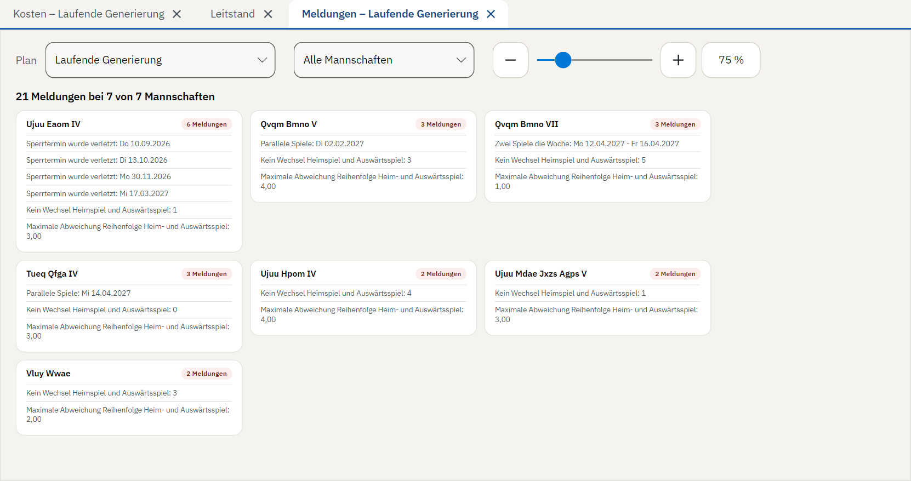

### 5.10 Gewichtungen anpassen

Die Gewichtungen legen fest, wie wichtig Ihnen die einzelnen Kostenarten sind. Es kommt nicht auf die Höhe der Kosten an, sondern auf ihr **Verhältnis** zueinander: Ist ein belegter Sperrtermin schlimmer als ein paralleles Spiel? Sind überlappende Spieltage wichtiger als ein Wechsel von Heim- und Auswärtsspielen? Die Standardgewichtung ist ein erprobter Mittelweg; jede Staffel ist aber anders.

Es gibt sieben Stufen: **Nicht berücksichtigen, sehr wenig, wenig, normal, hoch, sehr hoch, extrem hoch.**

Gewichten lässt sich auf drei Ebenen, die sich addieren:

1. **eine Kostenart für alle Mannschaften** – z. B. Sperrtermine *hoch*;
2. **alle Kosten einer Mannschaft** – z. B. eine Mannschaft, deren Wünsche besonders wichtig sind;
3. **eine Kostenart bei einer einzelnen Mannschaft** – z. B. die Sperrtermine nur dieser einen Mannschaft.

*Nicht berücksichtigen* auf irgendeiner Ebene schaltet die Kosten ganz ab.

**In der Kostenansicht:** Klicken Sie auf einen Spaltenkopf (Ebene 1), einen Mannschaftsnamen (Ebene 2) oder eine Zelle (Ebene 3). Im Detailfeld rechts wählen Sie die Stufe (*Nicht berücksichtigen* heißt dort kurz **aus**); die Änderung gilt sofort und wird gespeichert. Aus einer Zelle heraus springen **Kostenart für alle …** und **Ganze Mannschaft …** zur übergeordneten Ebene.

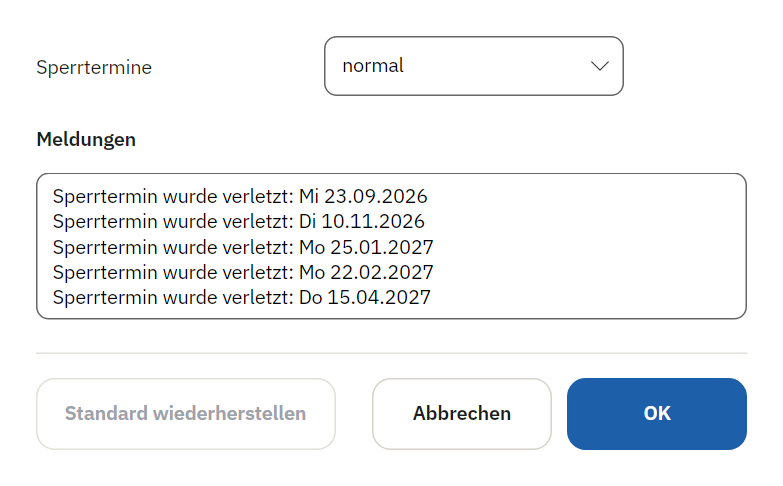

**In den Einstellungen** (links unter *Staffel*) finden Sie alle Gewichtungen auf einer Seite: die allgemeinen Plankosten, die Mannschaftskosten und die Gewichtung je Mannschaft. Unter den Mannschaftskosten stehen außerdem die Freitagsregel für die 60-km-Regel und die Regel für den Pflichtspieltag bei ungerader Mannschaftszahl (siehe [Pflichtspieltage](#pflichtspieltage)). Auch hier gilt jede Änderung sofort. **Standard wiederherstellen …** setzt alles auf die Ausgangswerte zurück.

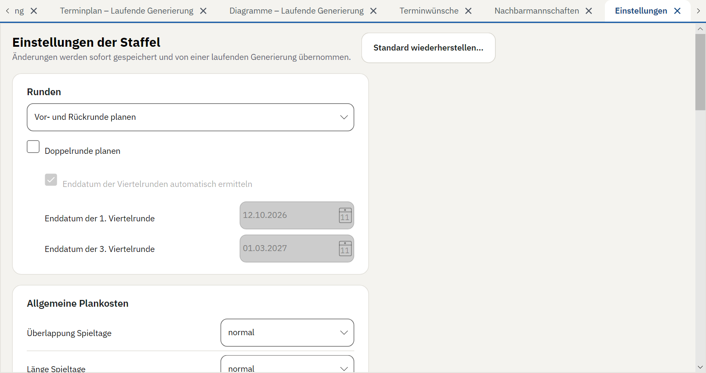

**So gehen Sie am besten vor**

- Ändern Sie immer nur **eine** Gewichtung und geben Sie dem Programm dann etwas Zeit, einen Plan für die neue Gewichtung zu finden.
- Jede Erhöhung hat ihren Preis: Was wichtiger wird, drängt alles andere zurück.
- Koppeltermine verschlechtern fast immer die übrigen Kriterien. Sollen möglichst viele erfüllt werden, müssen **Heimkoppel** und **Auswärtskoppel** meist höher gewichtet werden.
- Nach einer Änderung vergleicht die Kachel *Gesamtkosten* die Verbesserung ab dieser Änderung – die Kosten davor sind mit anderen Gewichten gerechnet und nicht vergleichbar.

### 5.11 Pläne merken und vergleichen

Um Pläne aus verschiedenen Einstellungen zu vergleichen, merken Sie sich Zwischenstände:

1. **Plan merken** (oben) anklicken – gemerkt wird der beste Plan der laufenden Generierung.
2. Einen Namen eingeben, z. B. „Sperrtermine hoch“.

Der Plan erscheint danach in jeder Ansicht in der Auswahl **Plan** und unter **Start mit**. Sie können ihn so ansehen, mit dem aktuellen vergleichen, als Ausgangsplan für eine neue Generierung nehmen oder entfernen: Ist er vor dem Start unter **Start mit** gewählt, steht oben an der Stelle von *Plan merken* der Knopf **Plan löschen**.

Gemerkte Pläne liegen im Datenordner der Staffel und stehen auch nach einem Neustart zur Verfügung.

### 5.12 Runden

Die Art der Runde stellen Sie in den **Einstellungen** unter **Runden** ein. Beim Öffnen schlägt das Programm eine passende Einstellung vor (siehe [Staffel einrichten](#33-die-staffel-einrichten)).

**Vor- und Rückrunde planen** ist der Normalfall und liefert die besten Ergebnisse.

**Halbrunde planen:** Manche Jugendligen spielen zwei Halbrunden statt Vor- und Rückrunde. In diesem Fall wird zwischen zwei Mannschaften nur ein Spiel geplant. Spielt die Halbrunde in Kompaktspieltagen, gilt Kapitel [6](#6-kompaktspieltage-planen).

**Nur Vorrunde / Nur Rückrunde planen:** In manchen Verbänden werden die Runden einzeln geplant, weil Vereine ihre Hallenzeiten für die Rückrunde noch nicht kennen. Nutzen Sie das nur aus diesem Grund – gemeinsam geplant werden die Pläne besser. Wird nur die Rückrunde geplant, berücksichtigt das Programm die in click-TT vorhandenen Spiele der Vorrunde. Auch der Export enthält dann nur die geplante Runde.

**Doppelrunde planen:** Jede Mannschaft spielt viermal gegen jede andere, in zwei Vor- und zwei Rückrunden (Viertelrunden). Das Programm ermittelt aus den Wunschterminen, wann die erste und die dritte Viertelrunde enden sollten. Passt das nicht, schalten Sie **Enddatum der Viertelrunden automatisch ermitteln** aus und tragen die Daten selbst ein.

**Coronarunde planen:** Plant nur die noch nicht gespielten Spiele der Rückrunde. Die Einstellung stammt aus der Saison 2020/21 und ist für Sonderfälle erhalten geblieben.

### 5.13 Bewertung der Pläne (Kosten)

Das Programm vergibt für ungünstige Konstellationen **Kosten**, etwa für einen belegten Sperrtermin. Gesucht wird der Plan mit den geringsten Gesamtkosten. Die absolute Höhe spielt keine Rolle, nur das Verhältnis der Kostenarten zueinander – und das bestimmen Sie über die Gewichtungen (Abschnitt [5.10](#510-gewichtungen-anpassen)).

Damit die Nachteile halbwegs gerecht verteilt werden, steigen die Kosten je Mannschaft in der Regel **quadratisch** mit der Zahl der Verstöße: Kostet ein Verstoß 100 Punkte, kosten zwei bei derselben Mannschaft 400. Zwei Verstöße bei einer Mannschaft wiegen also schwerer als je einer bei zwei Mannschaften.

In der Standardgewichtung haben die Kostenarten schon ein sinnvolles Verhältnis; eine belegte Halle zählt zum Beispiel mehr als ein paralleles Spiel.

#### Kosten des ganzen Plans

**Überlappung Spieltage** – Eine Mannschaft hat zu einem Zeitpunkt schon mehr als ein Spiel mehr absolviert als eine andere. Im Diagramm *Spieltage* sind diese Überlappungen grau hinterlegt.

**Länge Spieltage** – Ein Spieltag soll sich über möglichst wenige Tage erstrecken.

**Überlappung letzter Spieltag** und **Länge letzter Spieltag** – dasselbe, nur für den letzten Spieltag. Er soll möglichst kurz sein und so liegen, dass alle Mannschaften zuletzt nur noch ein Spiel haben. Anders als im Original zählen beim letzten Spieltag alle Überlappungen mit früheren Spieltagen, nicht nur die mit dem ältesten; die Kosten können deshalb etwas höher sein als im alten AndiGenerator.

**Vereinsinterne Spiele am Anfang** – Mannschaften desselben Vereins sollen zu Beginn jeder Halbrunde gegeneinander spielen.

#### Kosten je Mannschaft

**Hallenbelegung** – Die maximale Zahl gleichzeitiger Heimspiele in einer Halle ist überschritten.

**parallele Spiele** – Eine Nachbarmannschaft spielt am selben Tag. Nachbarmannschaft ist nur die direkt höhere oder niedrigere Mannschaft des Vereins: Für die 2. Herren zählen also die 1. und die 3. Herren. Die 4. zählt nur, wenn auch die 3. spielt. Sollen weitere Mannschaften nicht parallel spielen – etwa Bambini und 3. Jugend –, tragen Sie das bei den *Spielen der Nachbarmannschaften* ein.

**synchrone Heimspiele** – Ist bei einer Nachbarmannschaft eingestellt, dass gemeinsame Heimspiele erwünscht sind, versucht das Programm, die Heimspiele beider Mannschaften auf dieselben Tage zu legen. Die Kosten entstehen, wenn das nicht gelingt.

**Sperrtermine** – An einem Sperrtermin wird gespielt. Das Programm behandelt Sperrtermine als Wunsch, nicht als absolutes Verbot: Je mehr Sperrtermine eine Mannschaft meldet, desto weniger zählt der einzelne. Wer einen ganzen Monat sperrt, muss damit rechnen, dass nicht alle eingehalten werden; wer nur die drei Tage des örtlichen Altstadtfests sperrt, kann sich ziemlich sicher sein.

**Ausweichtermine** – Ein Ausweichtermin wurde verplant. Besser ist ein Plan, der ohne auskommt.

**60km Regel** – Ein Spiel, das wegen der weiten Anfahrt am Wochenende stattfinden soll, liegt unter der Woche. Ob der Freitag zum Wochenende zählt, legen Sie in den Einstellungen fest.

**3-Tage-Abstand** – Zwischen zwei Spielen einer Mannschaft liegen weniger als drei Tage; bei nur einem Tag entsprechend teurer.

**2-Spiele-die-Woche** – Eine Mannschaft hat zwei oder mehr Spiele in einer Woche. Koppeltermine sind ausgenommen.

**Spielverteilung** – Die Abstände zwischen den Spielen einer Mannschaft sollen ähnlich sein. Dabei zählen die gemeldeten Wunschtermine im Zeitraum: Bei vielen möglichen Terminen soll der Abstand kürzer sein, bei wenigen länger. Ferien gelten so nicht als Spielpause. Bei großen Staffeln ergibt sich eine gute Verteilung meist von allein; wichtig ist die Kostenart vor allem bei Staffeln mit wenigen Mannschaften.

**Heimkoppel** – Ein gewünschter Heimkoppeltermin oder Doppelspieltag wurde nicht eingeplant. Je Halbrunde wird höchstens ein Viertel der Staffelgröße als Koppeltermin vergeben: In einer Zehnerstaffel hat eine Mannschaft vier bis fünf Heimspiele je Halbrunde, möglich sind also zwei Koppeltermine.

**Auswärtskoppel** – Ein Auswärtskoppelwunsch wurde nicht erfüllt. Je mehr solcher Wünsche eine Mannschaft meldet, desto weniger zählt der einzelne.

**Ungleich H/A** – Die Zahl der Heimspiele in Vor- und Rückrunde ist verschieden bzw. weicht von den Vorgaben beim *Heimrecht* ab.

**Wechsel H/A** – Auf ein Heimspiel soll ein Auswärtsspiel folgen und umgekehrt. Siehe Diagramm *Wechsel Heim/Auswärts*.

**Abstand H/A** – Die Rückrunde soll die Gegner in ähnlicher Reihenfolge bringen wie die Vorrunde: Wer das letzte Vorrundenspiel gegen B hat, soll die Rückrunde nicht wieder mit B beginnen. Siehe Diagramm *Abstand Hin-/Rückspiel*.

**Setzliste** – Nah beieinander gesetzte Mannschaften treffen zu früh aufeinander. Je Runde soll eine Mannschaft erst gegen die weit entfernten Gegner spielen, zuletzt gegen die Nachbarn: Das k-te Spiel der Runde darf gegen einen Gegner gehen, der höchstens N − k Plätze entfernt ist (N Mannschaften). Die Einzelheiten nennen jedes Spiel, das das verletzt („Fr 04.12. gegen … (3 Plätze entfernt) ist das 10. Spiel der Runde – erlaubt bis zum 8.“; das Original hat dafür keine Meldungen).

**Pflichtspieltage** – Eine Mannschaft erreicht in einem vorgegebenen Zeitraum nicht die geforderte Zahl von Spielen.

#### Harte Fehler

Spiele ohne Termin, Spiele mit ungültigem Termin und Spiele an spielfreien Tagen gelten als harte Fehler und kosten je 10 Milliarden. Ein Plan mit harten Fehlern ist deshalb immer schlechter als jeder Plan ohne. In den ersten Sekunden einer Generierung sind sie normal; bleiben sie bestehen, fehlen meist Termine (siehe [Terminwünsche](#73-terminwünsche)).

## 6. Kompaktspieltage planen

Manche Staffeln – etwa die Jugend-Verbandsoberliga – spielen eine Halbrunde in **Kompaktspieltagen**: Drei oder vier Mannschaften treffen sich an einem Tag in einer Halle. Für solche Klassen hat AndiGenerator.NET einen eigenen Modus mit eigener Berechnung. Statt einen Plan lange zu verbessern, stellt er aus den Meldungen der Vereine gezielt Spieltage zusammen und bietet nach kurzer Zeit mehrere fertige Varianten an – mit Punkten, einer Karte der Fahrten und einem Ausdruck für die Vereine.

### 6.1 Was sind Kompaktspieltage?

| Form | Wer spielt | Spiele |
|---|---|---|
| **4er-Spieltag** | Der Ausrichter und eine zweite Mannschaft spielen je gegen die beiden anderen. | vier Spiele in zwei Runden, zwei Spiele parallel |
| **3er-Spieltag** | Jede gegen jede. | drei Spiele |
| **Einzelbegegnung** | Bei gerader Mannschaftszahl bleiben einzelne Begegnungen. | ein Spiel |

Kompaktspieltage finden an allen Sonntagen der Halbrunde statt und an Samstagen, für die eine Mannschaft einen Heimtermin gemeldet hat; ein Samstag gilt dabei wie jeder andere Tag (auswärts möglich, wenn die Mannschaft dort nicht gesperrt ist). Einzelbegegnungen gehen auch unter der Woche – an einem gemeldeten Heimtermin des Gastgebers, wenn die Hallen höchstens 60 km Luftlinie auseinanderliegen (60-km-Regel).

Jede Mannschaft soll mindestens einen 3er- oder 4er-Spieltag ausrichten; ein Einzel-Heimspiel zählt bei den Heimspieltagen mit, erfüllt diese Pflicht aber nicht. Einen 4er-Spieltag kann nur ausrichten, wer in seiner Halle zwei Spiele parallel austragen kann.

### 6.2 Der Weg zum Plan

1. **Meldungen in click-TT erfassen.** Die Vereine melden in den Terminwünschen von click-TT, wann sie ausrichten, auswärts spielen oder nicht können (Abschnitt [6.4](#64-meldungen-und-daten-aus-click-tt)).
2. **Staffel öffnen und einrichten.** XML-Datei, Bericht **Terminwünsche** (Pflicht, für Hallen und Entfernungen) und **Mannschaftsmeldung** (für Spitzen- und Abstiegsspieltag) herunterladen und alle drei zusammen öffnen (Abschnitte [3.1](#31-terminwünsche-aus-click-tt-herunterladen) und [3.2](#32-staffel-öffnen)) – oder die beiden letzten in der Einrichtung unter *Daten aus click-TT ergänzen* laden. Dann die Kompaktspieltage wählen (Abschnitt [6.3](#63-der-kompaktmodus)).
3. **Meldungen prüfen.** Im Raster der Ansicht **Kompaktspieltage** sehen Sie alle Meldungen auf einen Blick und ergänzen oder korrigieren sie dort direkt (Abschnitte [6.7](#67-meldungen-und-plan-karte) und [6.9](#69-meldungen-im-raster-bearbeiten)).
4. **Pläne berechnen** mit **▶** (Abschnitt [6.5](#65-pläne-berechnen)).
5. **Plan wählen.** Die Varianten vergleichen, einen Plan wählen und merken (Abschnitte [6.6](#66-pläne-und-punkte) und [6.10](#610-pläne-sichern-und-merken)).
6. **Drucken und exportieren.** Die Übersicht für die Vereine drucken, den Plan für click-TT exportieren und dort beim 4er-Spieltag die Spiele der zweiten „Heimmannschaft“ in die Halle des Ausrichters verlegen (Abschnitt [6.11](#611-drucken-und-export-für-click-tt)).

### 6.3 Der Kompaktmodus

Ob eine Klasse in Kompaktspieltagen geplant werden kann, erkennt das Programm beim Öffnen: Es muss eine Halbrunde sein („(HR)“ bzw. „(FR)“ im Namen oder Runde kürzer als sechs Monate), deren Spieltage überwiegend am Wochenende liegen – zwei oder drei Termine unter der Woche für einzelne Spiele stören nicht. Dann erscheint in der Einrichtung der Punkt **Klasse mit Kompaktspieltagen** mit einer Erklärung und der Wahl, ob die Staffel so geplant wird. Vorgewählt ist **Mit Kompaktspieltagen planen**; das gilt auch, wenn Sie ohne weiteren Klick **Abschließen** – für die normale Planung klicken Sie **Normal planen** an. Wer es eingeschaltet hat, wird beim nächsten Öffnen noch einmal gefragt und kann es zurücknehmen; danach lässt es sich in der Ansicht **Kompaktspieltage** aus- und einschalten.

Die Ansicht **Kompaktspieltage** steht links oben unter *Ansichten* – nur bei Klassen, die dafür in Frage kommen. Sind die Kompaktspieltage eingeschaltet, arbeitet das Hauptfenster im **Kompaktmodus**:

- Die Ansicht *Kompaktspieltage* ist die Hauptansicht. Sie zeigt die Pläne, das Raster „Meldungen und Plan“, die Karte, die Spieltage und die Hinweise.
- **▶** berechnet die Pläne der Kompaktspieltage statt einer Kostenoptimierung.
- *Kosten*, *Qualität* und *Meldungen* sowie die Wahl des Verfahrens entfallen; Kosten und Gewichtungen spielen keine Rolle.
- Terminplan, Diagramme, Terminwünsche, Nachbarmannschaften, Einstellungen, Druck und Export bleiben.

### 6.4 Meldungen und Daten aus click-TT

**Die Meldungen** kommen aus den Terminwünschen in click-TT: Ein Tag mit Uhrzeit ist ein möglicher Heimspieltag, ein Sonntag ohne Eintrag ein möglicher Auswärtsspieltag, `frei` heißt „kann nicht“. **Max. Heimspiele 2** bei einem Heimtermin heißt, dass in der Halle zwei Spiele parallel gehen – nur dann kann die Mannschaft einen 4er-Spieltag ausrichten. „An diesem Tag nur Heimspiel“ steht als Zeile `Nur Heim: 18.10., 01.11.` in den Bemerkungen des Vereins. Wie man das in click-TT erfasst, beschreibt [Kompaktspieltage erfassen](KOMPAKTSPIELTAGE.md).

**Entfernungen** sind Luftlinie zwischen den Hallen, aus den Adressen des Berichts *Terminwünsche* (Postleitzahl und Ort bzw. GPS-Angabe). Bei Klassen für Kompaktspieltage ist dieser Bericht deshalb Pflicht: Die Einrichtung lässt sich erst abschließen, wenn er im ersten Punkt *Daten aus click-TT ergänzen* geladen ist. Die QTTR-Schnitte für Spitzen- und Abstiegsspieltag kommen aus der Mannschaftsaufstellung, die dort ebenfalls geladen wird.

**Uhrzeiten:** Ohne Uhrzeit am Heimtermin des Ausrichters beginnt der 4er-Spieltag um 11 Uhr, der 3er-Spieltag um 10 Uhr; sonst zur eingetragenen Uhrzeit. Die Runden folgen im Abstand von drei Stunden.

### 6.5 Pläne berechnen

Der Knopf **▶** berechnet die Pläne. Jede mögliche Kombination aus Spieltag und Tag ist dabei eine Ja/Nein-Entscheidung, die der freie Löser **HiGHS** als ganzzahlige Optimierung löst: jede Paarung genau einmal, jede Mannschaft höchstens einmal am Tag, jede richtet mindestens einen Spieltag aus, möglichst ohne Verstöße gegen die Meldungen. So findet der Planer den kürzesten Plan und den Plan mit den wenigsten Punkten nachweisbar – auch bei knappen Meldungen. Unabhängige Schritte rechnen gleichzeitig, und jeder Schritt lässt mehrere Läufe des Lösers mit verschiedenen Startwerten parallel laufen; der erste, der den besten Plan beweist, beendet die anderen. Eine Zufallssuche liefert die Startpunkte und ergänzt am Ende weitere Varianten. Bei 9 Mannschaften (oder 10 mit je einer Einzelbegegnung) geht der Plan genau mit 4er-Spieltagen auf; Pläne mit 3er-Spieltagen erscheinen dann nur, wenn sie ein Ziel besser treffen als jeder reine 4er-Plan (*Mit 3er-Spieltagen: kürzer*, *… gleich weite Fahrten* usw., höchstens drei).

> **Windows-Laptops mit ARM-Prozessor:** Für die ARM-Fassung des Programms (`…-win-arm64-Setup.exe`) gibt es HiGHS noch nicht. Sie plant Kompaktspieltage mit der vollständigen Suche ohne Löser – das dauert länger und findet bei knappen Meldungen nicht immer den kürzesten Plan. Wer dort Kompaktspieltage plant, installiert besser die normale Fassung (`AndiGeneratorNET-win-Setup.exe`); sie läuft auch auf ARM-Laptops und bringt HiGHS mit.

Während der Berechnung zeigt ein Fortschrittsbalken den laufenden Schritt. Der Hauptknopf (Pause) hält sie an: Die Ansicht zeigt dann die bisher besten Pläne; Fortsetzen rechnet weiter und behält dabei nur den gewählten. **Stopp** (■) beendet die Berechnung mit den bis dahin besten Plänen. Solange die Meldungen bearbeitet werden (Abschnitt [6.9](#69-meldungen-im-raster-bearbeiten)), lässt sich die Berechnung nicht starten.

### 6.6 Pläne und Punkte

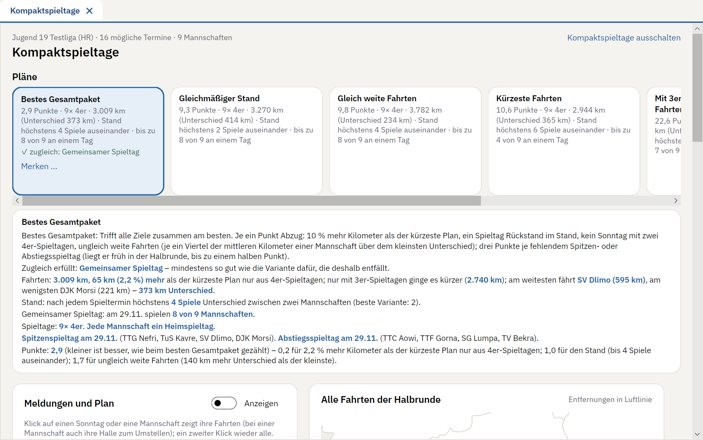

Unter **Pläne** stehen der Plan aus click-TT, der gesicherte und die gemerkten Pläne der Staffel sowie die Varianten der letzten Berechnung – aufsteigend nach **Punkten** (weniger ist besser, die Zahl steht auf jeder Karte):

- **Bestes Gesamtpaket** – trifft alle Ziele zusammen am besten; nach der Berechnung ist es gewählt.
- **Kürzeste Fahrten**, **Gleich weite Fahrten** (kleinster Unterschied zwischen der Mannschaft mit den meisten und der mit den wenigsten Kilometern), **Gleichmäßiger Stand**, **Gemeinsamer Spieltag** (möglichst viele Mannschaften am selben Sonntag), **Spitzen- und Abstiegsspieltag** (die vier stärksten und die vier schwächsten Mannschaften nach QTTR-Schnitt bilden je einen 4er-Spieltag, so spät wie möglich) und ein **Weiterer Plan mit anderen Spieltagen** zur Auswahl.
- **Ohne Verstöße** bzw. **… mit Einzelspielen**, wenn alle anderen Pläne gegen Meldungen verstoßen.

Trifft das Gesamtpaket ein Ziel einer anderen Variante schon mindestens ebenso gut, entfällt diese und die Karte des Gesamtpakets nennt es unter **✓ zugleich**.

**Die Punkte:** 10 je Verstoß gegen die Meldungen, 15 je Mannschaft ohne 3er- oder 4er-Heimspieltag (2 weitere, wenn sie gar kein Heimspiel hat), 3 je fehlendem Spitzen- oder Abstiegsspieltag (liegt er früh in der Halbrunde, ein halber Punkt), 3 je 3er-Spieltag, wenn ein reiner 4er-Plan möglich wäre, und je ein Punkt für 10 % mehr Kilometer als der kürzeste Plan (Fahrten zu Einzelbegegnungen zählen doppelt), einen Spieltag Rückstand im Stand, keinen Sonntag mit zwei 4er-Spieltagen und ungleich weite Fahrten.

Ein Klick zeigt einen Plan und erläutert ihn darunter: wofür er steht, Fahrten (gesamt, weiteste und kürzeste Mannschaft), Stand, gemeinsamer Sonntag, Heimspieltage, Verstöße, Spitzen- und Abstiegsspieltag und seine Punkte mit den Gründen. Der gewählte Plan gilt für Terminplan, Diagramme, Druck und den Export für click-TT – ein gesicherter oder gemerkter Plan genau so, wie er gespeichert wurde (Uhrzeiten, Hallen, Heimrecht).

### 6.7 Meldungen und Plan, Karte

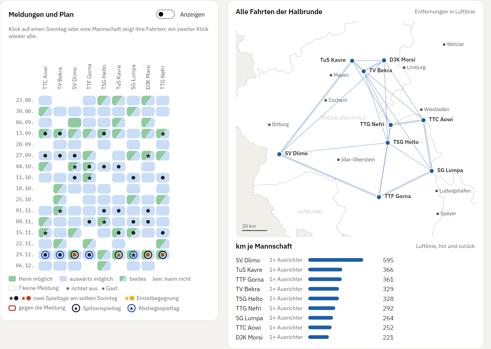

**Meldungen und Plan:** je Tag eine Zeile, je Mannschaft eine Spalte (Namen senkrecht). Die Farbe zeigt die Meldung: grün Heim möglich, blau auswärts möglich, halb und halb beides, ? keine Meldung; leer heißt „kann nicht“. Darauf ★ für den Ausrichter und ● für die Gäste; ein zweiter Spieltag am selben Tag hat orange Zeichen (ein dritter orangefarbene), Einzelbegegnungen gelbe. Ein schwarzer Ring um die Zeichen markiert den Spitzenspieltag, ein blauer den Abstiegsspieltag. Rot umrandet ist, was der Meldung widerspricht. Der Tooltip eines Felds nennt Meldung, Rolle, Halle und Beginn.

**Karte:** die Hallen auf einer Karte mit den Bundesländern und einigen Städten, gezoomt auf die Spielorte, dazu die Fahrten als Pfeile von der Halle des Gasts (grün umrandet) zur Halle des Ausrichters in der Farbe des Spieltags – in den Karten je Sonntag bzw. Spieltag wie ★ und ● im Raster: der erste Spieltag eines Sonntags schwarz, der zweite orangerot, der dritte violett; in den Karten je Mannschaft blau. Einzelbegegnungen sind immer gelb. Die Legende unter dem Raster nennt nur die Farben, die im Plan vorkommen. Fahren zwei Mannschaften dieselbe Strecke in dieselbe Richtung, zeigt ein Pfeil aus zwei Hälften in beiden Farben beide Fahrten. Fährt eine Mannschaft zweimal zum selben Ausrichter (zwei Spieltage dort), ist der Pfeil ebenso geteilt – eine helle Mittellinie trennt die beiden Hälften derselben Farbe –, und der Punkt des Ausrichters ist in zwei Hälften geteilt. Kurze Fahrten liegen hell umrandet im Vordergrund. An jedem Spielort steht der volle Mannschaftsname wie in click-TT (ab der zweiten Mannschaft mit Nummer) – keine Ortsnamen, denn in einer Stadt wie Hamburg hieße sonst jeder Ort gleich. Ist neben dem Punkt kein Platz, steht der Name etwas weiter weg und eine dünne Linie führt zum Punkt; reicht auch das nicht (etwa bei vielen Hallen dicht beieinander), steht am Punkt eine Nummer und der Name in einer Legende in einer freien Ecke der Karte. Die Karte ist so gezoomt, dass auch eine Klasse innerhalb einer Stadt groß erscheint. Ein Klick auf einen Tag, eine Mannschaft (im Raster oder in der Liste *km je Mannschaft*) oder einen Spieltag zeigt nur dessen Fahrten und hebt die passenden Zeilen, Spalten und Spieltage hervor; ein zweiter Klick zeigt wieder alle. Über einem Spielort nennt ein Hinweis Mannschaft und Halle.

### 6.8 Spieltage und Hinweise

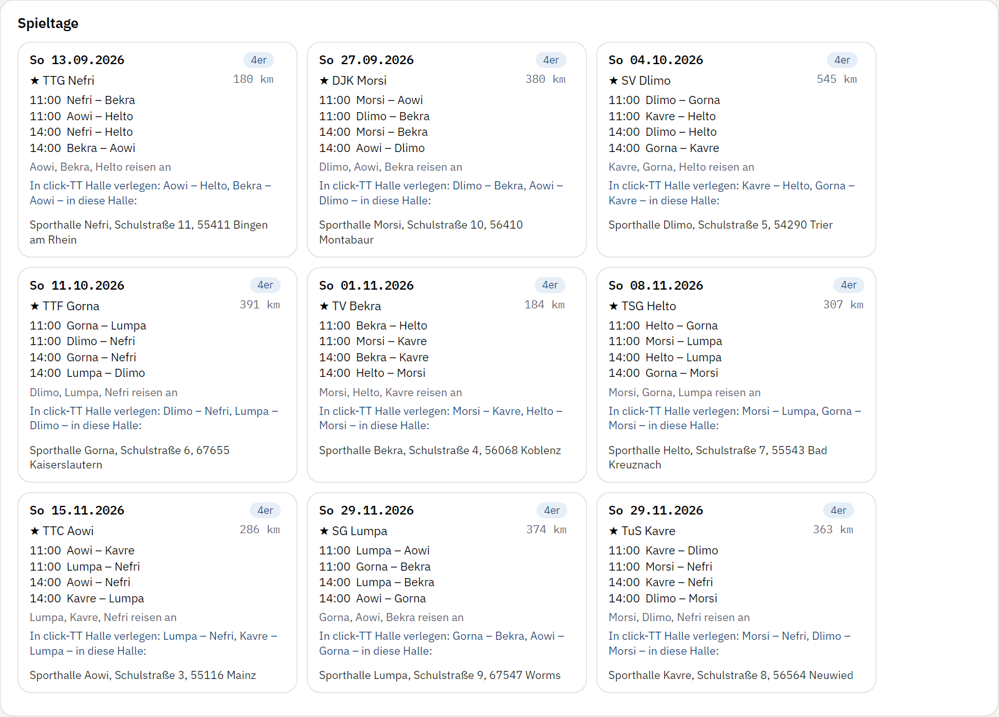

**Spieltage:** je Spieltag Ausrichter, Spiele mit Beginn und km. Beim 4er-Spieltag steht dabei, bei welchen Spielen Sie in click-TT die Halle des Ausrichters eintragen, mit deren Adresse aus dem Bericht *Terminwünsche* zum Markieren und Kopieren (die zweite „Heimmannschaft“ ist in Wahrheit Gast). Die Spielfolge ist Ausrichter – Gast 1 und Partner – Gast 2, danach Ausrichter – Gast 2 und Gast 1 – Partner; so ist der Partner nur einmal formal Heimmannschaft.

**Hinweise:** Verstöße, Widersprüche, Mannschaften ohne Meldung oder ohne bekannte Halle und die Bemerkungen der Vereine.

### 6.9 Meldungen im Raster bearbeiten

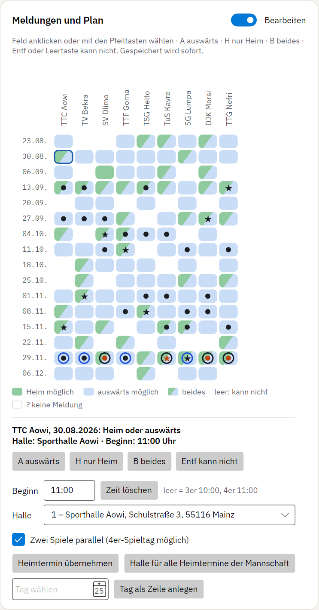

Mit dem Schalter **Bearbeiten** über dem Raster steht ein Rahmen auf einem Feld; Sie bewegen ihn per Klick oder mit den Pfeiltasten. **A** heißt nur auswärts, **H** nur Heim, **B** beides, **Entf** oder **Leertaste** kann nicht. Für einen Heimtermin stellen Sie darunter Beginn, Halle und „Zwei Spiele parallel“ (nötig für einen 4er-Spieltag) ein. Ein leerer Beginn bedeutet den Standard – 3er-Spieltag 10 Uhr, 4er-Spieltag 11 Uhr –, eine eingetragene Uhrzeit gilt so, wie sie ist; **Zeit löschen** setzt wieder den Standard. **Halle für alle Heimtermine der Mannschaft** macht die gewählte Halle zur Standardhalle der Mannschaft. Schneller geht es mit einem Klick auf den Namen der Mannschaft über dem Raster (auch ohne Bearbeiten): Unter dem Raster steht dann **Halle aller Heimspiele von …** mit der Liste ihrer Hallen; **Für alle Heimspiele** setzt die gewählte Halle für alle Heimtermine der Mannschaft und macht sie zur Standardhalle, so dass auch Heimtermine, die danach eingetragen werden, sie bekommen. Weitere Tage (etwa ein Samstag) legen Sie mit **Tag als Zeile anlegen** an; ihre Felder sind zunächst leer. Gespeichert wird sofort, wie in den Spielplandaten: als Heimtermin, Sperrtermin bzw. Zeile „Nur Heim: …“ in der Bemerkung.

### 6.10 Pläne sichern und merken

Den gewählten berechneten Plan merken Sie direkt auf seiner Karte mit **Merken …**. Gemerkte Pläne, der gesicherte Plan und der Plan aus click-TT stehen danach unter **Pläne** neben den Varianten, mit Punkten und Kennzahlen; gewählt gelten sie genau so, wie sie gespeichert wurden (Uhrzeiten, Hallen, Heimrecht).

Wie bei normalen Runden sichert das Programm den aktuellen Plan, bevor er verworfen würde (Abschnitt [5.3](#53-die-generierung-steuern)). Im Kompaktmodus vergleicht die Rückfrage dabei die Kennzahlen der Kompaktspieltage: Verstöße gegen die Meldungen, Mannschaften ohne Heimspieltag, die Spieltage (4er, 3er, Einzel), Fahrten gesamt, den Unterschied zwischen weitester und kürzester Mannschaft, den Stand, wie viele Mannschaften höchstens am selben Sonntag spielen und – wenn die QTTR-Werte bekannt sind – Spitzen- und Abstiegsspieltag; insgesamt besser ist der Plan mit weniger Punkten, gezählt wie beim besten Gesamtpaket. Sie wählen **Aktuellen Plan sichern**, **Gesicherten Plan behalten** oder **Abbrechen**.

### 6.11 Drucken und Export für click-TT

Im Kompaktmodus druckt **Drucken** nur die **Übersicht für die Vereine**, immer im Hochformat und mit dem Plan, der in der Ansicht *Kompaktspieltage* gewählt ist; der Dialog nennt ihn. Die übrigen Drucke für normale Runden entfallen hier: Terminwünsche, Spielplan und Mannschaftspläne stehen schon in der Übersicht, Nachbarmannschaften spielen bei Kompaktspieltagen keine Rolle, und die Diagramme bewerten normale Runden. Gibt es noch keinen Plan, sagt der Dialog das, und es lässt sich nichts drucken. Jeder Teil beginnt auf einer neuen Seite: der Klassenname mit dem Raster „Meldungen und Plan“ samt Legende, die Karte aller Fahrten mit „km je Mannschaft“ darunter, die Spieltage (Datum, Form, Ausrichter, Halle und Begegnungen mit Beginn) und für jede Mannschaft genau eine Seite mit der **Karte ihrer Fahrten** und ihren Spieltagen (Ort, Gegner, Uhrzeiten, Halle). Hinweise für die Staffelleitung (zu verlegende Hallen, Verstöße) stehen nicht darin. Die Karten sind dieselbe Zeichnung wie in der Ansicht.

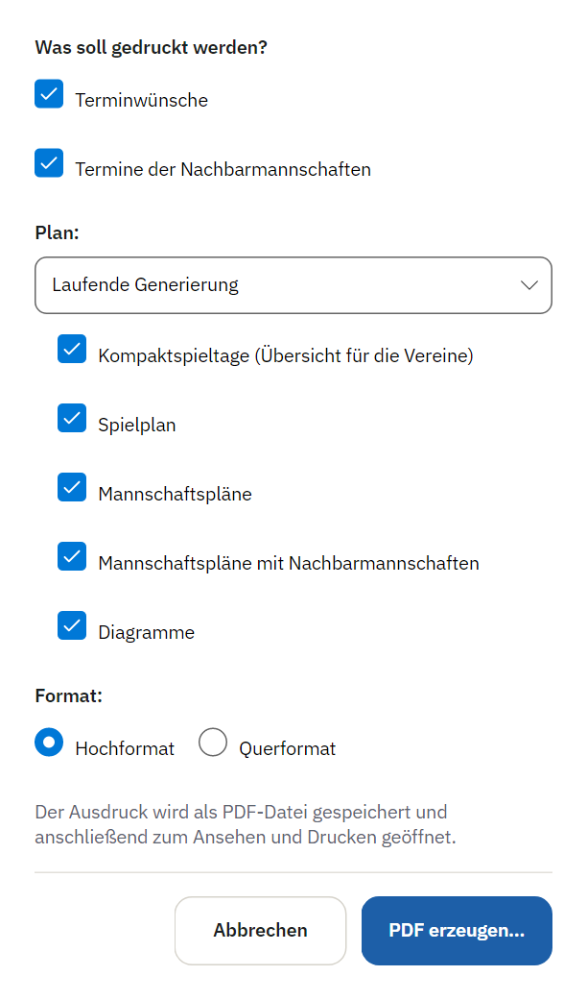

Der **Export für click-TT** prüft den Plan vorher mit den Hinweisen der Kompaktspieltage (nicht mit der Prüfung für normale Pläne) und listet sie, falls es welche gibt. Die Spiele des Ausrichters erhalten das Spiellokal seines Heimtermins an diesem Tag (sonst seine Standardhalle); Spiele der zweiten „Heimmannschaft“ bleiben ohne Spiellokal, weil click-TT nur Hallen des Heimvereins kennt – sie verlegen Sie in click-TT in die Halle des Ausrichters. Welche Spiele das sind, steht bei den Spieltagen (Abschnitt [6.8](#68-spieltage-und-hinweise)).

### 6.12 Grenzen

Bei wenigen Mannschaften (5 oder 6) gibt es zu wenige Spieltage, als dass jede Mannschaft einen ausrichten könnte; der Planer sagt das dann. Lässt sich kein Plan ohne Verstöße gegen die Meldungen finden, erlaubt er welche und nennt sie.

## 7. Ansichten für beide Arten der Planung

Die Ansichten **Terminplan** und **Diagramme** zeigen einen Plan. Bei normalen Runden wählen Sie ihn oben in der Ansicht unter **Plan**: den besten Plan der laufenden Generierung, den in click-TT vorhandenen Plan oder einen gemerkten Plan. Im Kompaktmodus gilt der Plan, der in der Ansicht *Kompaktspieltage* gewählt ist (Abschnitt [6.6](#66-pläne-und-punkte)).

Die Ansichten **Terminwünsche** und **Nachbarmannschaften** hängen nicht vom Plan ab, sondern nur von den Daten der Staffel.

### 7.1 Terminplan

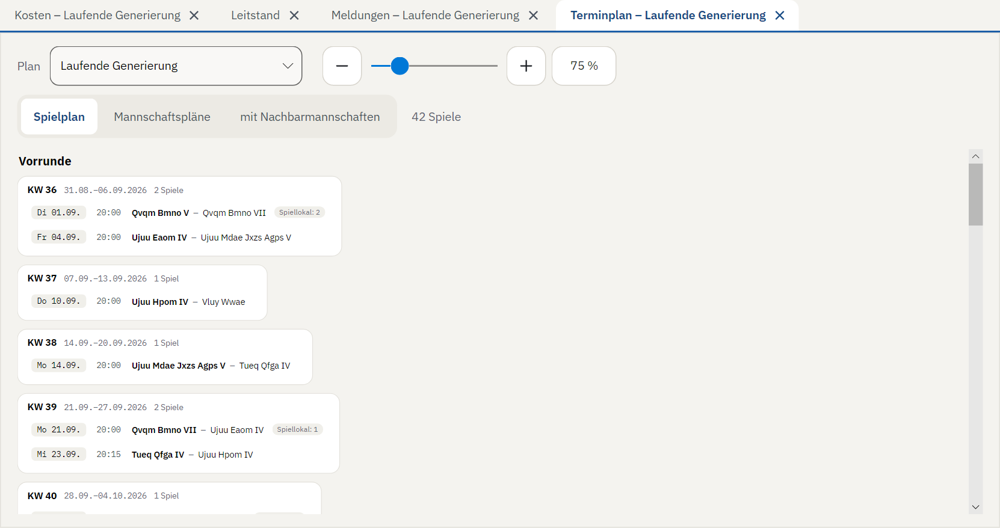

Der Terminplan zeigt die Spiele in drei Darstellungen (Umschalter oben):

- **Spielplan** – alle Spiele nach Kalenderwochen;
- **Mannschaftspläne** – je Mannschaft ihre Spiele, mit der Heim/Auswärts-Folge als Punkten (gefüllt = Heimspiel, hohl = Auswärtsspiel);
- **mit Nachbarmannschaften** – die Mannschaftspläne zusätzlich mit den Spielen der Nachbar- und Vereinsmannschaften am selben Tag.

**Hinweise** stehen als farbige Marken am Spiel: rot bei Verstößen (spielfreier Tag, kein Wunschtermin, doppeltes Spiel, ungültiger Termin), ocker bei Dingen, die zu beachten sind (Ausweichtermin, wegen Koppeltermin geänderte Uhrzeit), blau bei Informationen (Koppelspiel, manuell festgelegter Termin) und grau beim Spiellokal. Ein Klick auf ein Spiel zeigt rechts die Einzelheiten mit einer Erklärung jedes Hinweises.

**Spiele ohne Termin** stehen immer am Anfang.

### 7.2 Diagramme

Die Diagramme zeigen auf einen Blick, wie sich der Plan für die Mannschaften anfühlt. Oben wählen Sie das Diagramm; jedes hat eine kurze Beschreibung.

**Spieltage** – wann jede Mannschaft spielt und über welchen Zeitraum sich jeder Spieltag erstreckt. Überlappungen der Spieltage sind grau hinterlegt. Große dunkle Flächen bedeuten, dass die Spieltage stark ineinanderlaufen: Manche Mannschaften sind schon zwei Spiele weiter als andere.

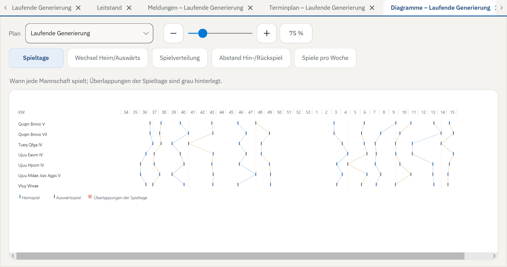

**Wechsel Heim/Auswärts** – die Folge der Heim- und Auswärtsspiele je Mannschaft. Ideal ist ein Zickzack: auf ein Heimspiel folgt ein Auswärtsspiel. Waagerechte Stücke sind Serien von Heim- oder Auswärtsspielen. Ganz ohne Serien geht es selbst bei idealen Meldungen nicht.

**Spielverteilung** – die Termine jeder Mannschaft über die Saison. Hier sieht man, ob die Spiele gleichmäßig verteilt sind oder ob sich Spiele ballen und dazwischen lange Pausen liegen. Kleine Quadrate markieren Koppeltermine.

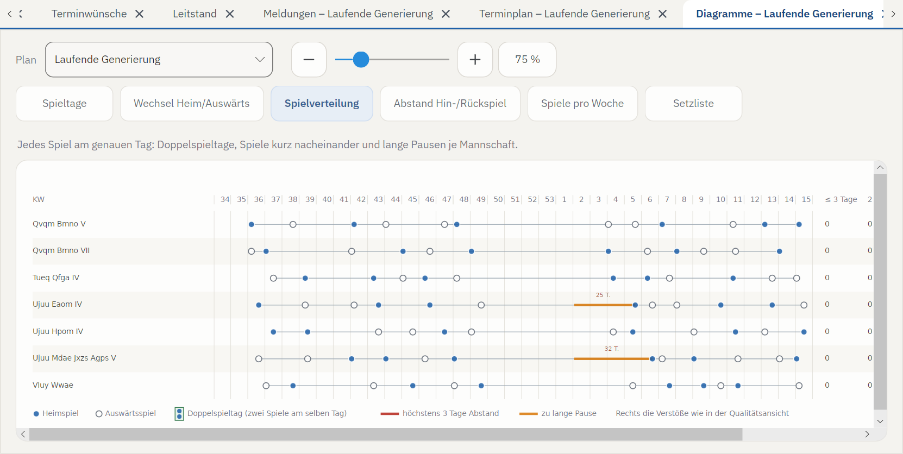

**Abstand Hin-/Rückspiel** – wie weit Heim- und Auswärtsspiel gegen denselben Gegner auseinanderliegen. Ungünstige Konstellationen, etwa Hin- und Rückspiel kurz hintereinander, sind rot markiert.

**Spiele pro Woche** – wie viele Spiele jede Mannschaft je Woche hat, und nach dem Schrägstrich, wie viele sie bis dahin insgesamt gespielt hat. Die letzte Zeile nennt die größte Differenz zwischen den Mannschaften am Ende der Woche: Hat nach der dritten Woche eine Mannschaft drei Spiele gemacht und eine andere keines, steht dort 3.

**Setzliste** (nur mit aktiver Setzliste) – für jedes Spiel als Balken, wie weit die beiden Gegner in der Setzliste auseinanderliegen. Mannschaften, die nah beieinander gesetzt sind, sollen erst gegen Ende gegeneinander spielen – Erster gegen Zweiten möglichst am letzten Spieltag. Ideal liegen alle Balken unter der grauen Linie. Überbewerten sollte man das nicht: Die Setzliste ist nur eine Vermutung, und Sperrtermine oder enge Spielfolgen sind den Mannschaften meist wichtiger.

### 7.3 Terminwünsche

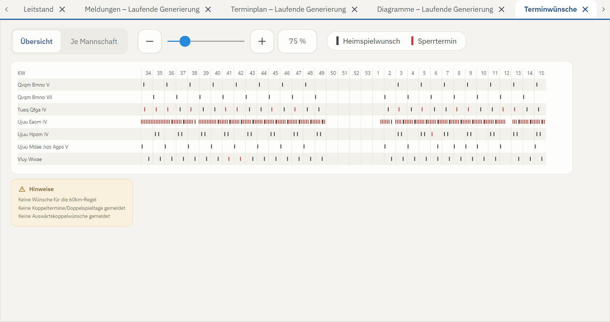

Die Ansicht zeigt, was die Vereine gemeldet haben, auf zwei Seiten (Umschalter oben):

- **Übersicht:** ein Raster aller Heimspielwünsche (dunkle Striche), Koppeltermine (blau) und Sperrtermine (rot) über die ganze Saison, darunter allgemeine Hinweise zur Staffel.
- **Je Mannschaft:** eine Karte pro Mannschaft mit ihren Wünschen, Koppelpartnern, Spiellokal, Hallenbelegung durch Nachbarn, Sperrterminen, Auswärtskoppeln, 60-km-Regel, Heimrecht und der Auswertung, ob die gemeldeten Termine ausreichen. Karten mit Problemen stehen vorn.

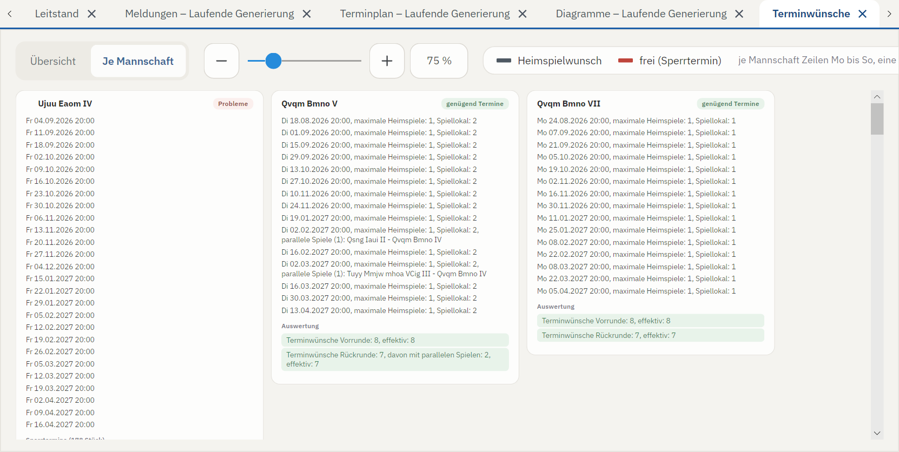

Hat eine Mannschaft zu wenige Termine gemeldet, bleiben einzelne Spiele ohne Termin. Beim Export werden sie auf den ersten Tag der Runde um 00:00 Uhr gesetzt und müssen in click-TT von Hand terminiert werden.

### 7.4 Nachbarmannschaften

Die Ansicht zeigt die Spiele aus anderen Staffeln, die mit der XML-Datei eingelesen wurden: je Tag, welche Nachbar- und Vereinsmannschaften spielen. Sie dient zur Kontrolle, was click-TT übertragen hat und welche Staffeln dort schon terminiert sind. Direkte Nachbarmannschaften sind anders markiert als weitere Vereinsmannschaften.

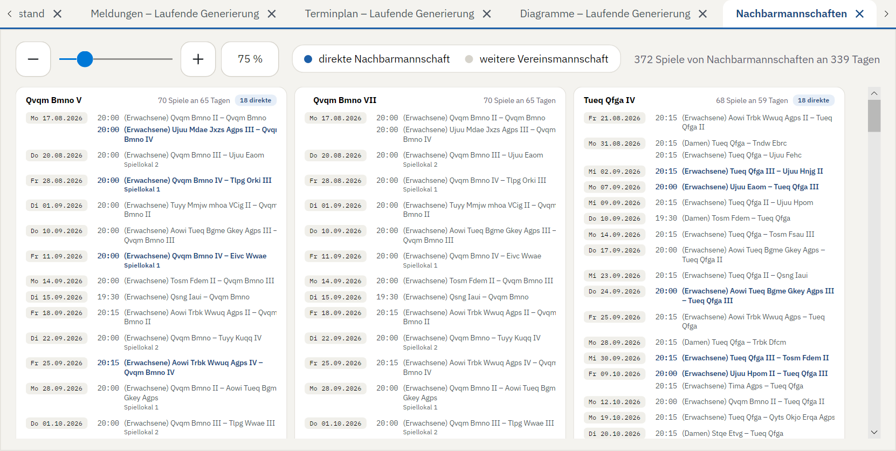

## 8. Export und Druck

### 8.1 Für click-TT exportieren

**Für click-TT exportieren** (linke Leiste, *Ausgabe*, farblich hervorgehoben) speichert den **gerade angezeigten Plan** als CSV-Datei, die click-TT als Spielplan importiert: den Plan, den die aktive Ansicht zeigt (laufende Generierung, click-TT-Plan oder ein gemerkter Plan), sonst den Stand der Generierung bzw. den unter *Start mit* gewählten Plan. Welcher es ist, verrät der Tooltip. Gibt es keinen Plan, ist der Eintrag grau und nicht anklickbar. Exportieren Sie den laufenden Plan, pausieren Sie die Generierung vorher, damit er sich nicht mehr ändert.

Vor dem Export prüft das Programm auf harte Fehler: Spiele ohne Termin, Spiele mit ungültigem Termin und Spiele an spielfreien Tagen. Gibt es welche, werden sie aufgelistet, und Sie entscheiden, ob Sie trotzdem exportieren. Spiele ohne Termin stehen in der CSV-Datei am ersten Tag der Runde um 00:00 Uhr.

Die Spiellokale werden mit exportiert. Sie müssen dafür Nummern von 1 bis 5 sein, so wie click-TT sie erwartet.

Wurde nur die Vor- oder nur die Rückrunde geplant, enthält die CSV-Datei auch nur deren Spiele.

Im Kompaktmodus exportiert das Programm den in der Ansicht *Kompaktspieltage* gewählten Plan und prüft ihn mit den Hinweisen der Kompaktspieltage; wie die Spiellokale dabei gesetzt werden, steht in Abschnitt [6.11](#611-drucken-und-export-für-click-tt).

### 8.2 Drucken (PDF)

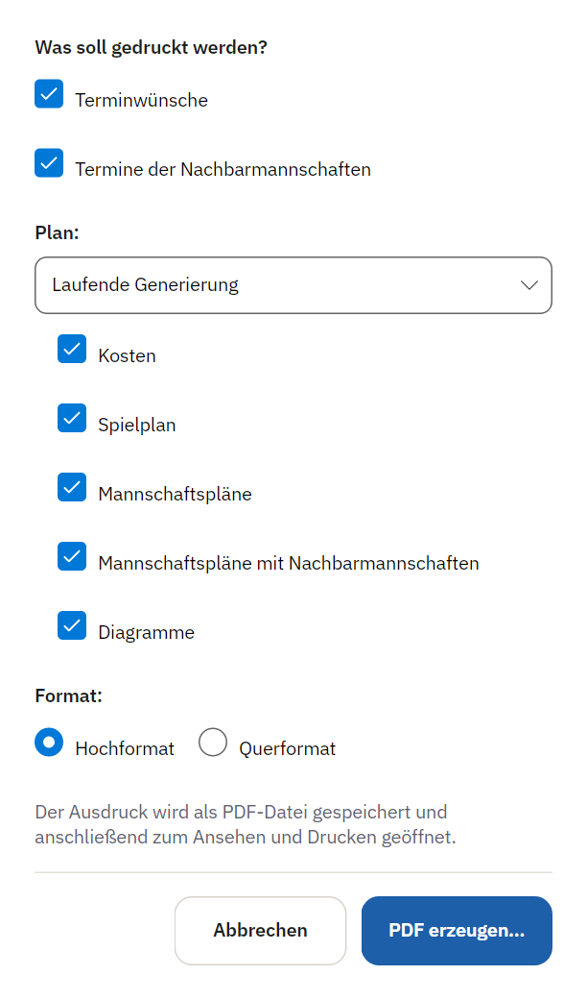

**Drucken (PDF)** erzeugt einen Ausdruck als PDF-Datei und öffnet ihn anschließend zum Ansehen und Drucken. Im Dialog wählen Sie:

- **welcher Plan** gedruckt wird,
- **was** gedruckt wird: Terminwünsche, Termine der Nachbarmannschaften, Kosten, Spielplan, Mannschaftspläne, Mannschaftspläne mit Nachbarmannschaften, Diagramme,
- **Hoch- oder Querformat**.

Jeder Abschnitt beginnt auf einer neuen Seite; zu breite Tabellen und Diagramme werden passend verkleinert. Solange es noch keinen Plan gibt, lassen sich nur Terminwünsche und Termine der Nachbarmannschaften drucken.

Im Kompaktmodus gibt es nichts zu wählen: Gedruckt wird die **Übersicht für die Vereine** mit dem in der Ansicht gewählten Plan, im Hochformat (Abschnitt [6.11](#611-drucken-und-export-für-click-tt)).

## 9. Spielplandaten bearbeiten

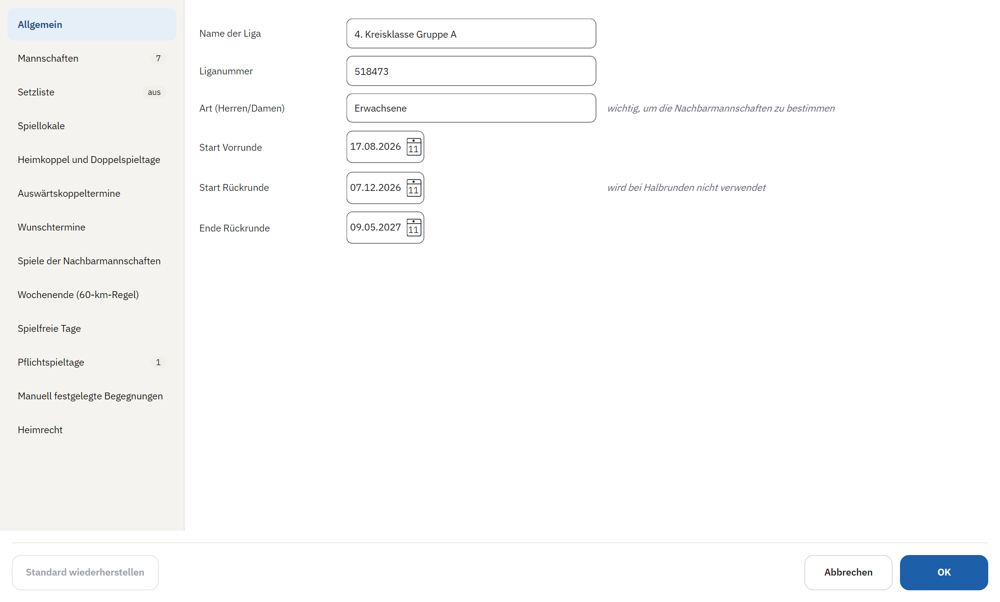

Unter **Spielplandaten** lassen sich alle Daten ändern, die click-TT geliefert hat. Links wählen Sie die Seite, bei Seiten je Mannschaft daneben die Mannschaft. Mit **OK** werden die Änderungen übernommen und in der `.modifications`-Datei neben der XML-Datei gespeichert; **Abbrechen** verwirft sie. Eine laufende Generierung übernimmt die Änderungen sofort.

Weil die Änderungen getrennt von der XML-Datei gespeichert werden, können Sie die XML-Datei jederzeit neu aus click-TT herunterladen: Speichern Sie sie unter demselben Namen, bleiben Ihre Änderungen erhalten.

Die Seiten werden überall gleich bedient: Die Knöpfe **Neu**, **Bearbeiten** und **Löschen** (bei der Setzliste **Nach oben**/**Nach unten**) stehen auf jeder Seite gleich: hellblau hervorgehoben, gleich breit und direkt rechts neben der Liste – auch wenn das Fenster breiter oder schmaler wird; ein **Doppelklick** oder die **Eingabetaste** bearbeitet den gewählten Eintrag, die **Entf**-Taste löscht ihn (mit Rückfrage). In der Seitenliste links steht bei manchen Seiten eine kleine Marke – die Zahl der Einträge (Mannschaften, spielfreie Tage, Pflichtspieltage, festgelegte Begegnungen) bzw. „an“/„aus“ bei der Setzliste –, und ein blauer Punkt zeigt, auf welchen Seiten Sie in diesem Dialog etwas geändert haben.

Bei Kompaktspieltagen erfassen Sie die Meldungen bequemer direkt im Raster der Ansicht *Kompaktspieltage* (Abschnitt [6.9](#69-meldungen-im-raster-bearbeiten)); gespeichert wird dort genauso wie hier.

### Allgemein

Die Stammdaten der Liga: Name, Liganummer, Art (Herren, Damen …) sowie Start der Vorrunde, Start der Rückrunde und Ende der Rückrunde. Die Art ist wichtig, um die Nachbarmannschaften richtig zu bestimmen. Der Start der Rückrunde wird bei Halbrunden nicht verwendet. Beide Hinweise stehen direkt neben den Feldern; passt eine Eingabe nicht (z. B. leerer Name), steht das sofort rot darunter.

### Mannschaften

Mannschaften anlegen, bearbeiten und löschen. Über die **Vereins-ID** erkennt das Programm, welche Mannschaften zu einem Verein gehören; über die **Mannschaftsnummer** (1., 2., 3. Mannschaft …) die echten Nachbarmannschaften. Ein Spiellokal tragen Sie nur ein, wenn der Verein in mehreren Hallen spielt.

### Setzliste

Mit der Setzliste geben Sie die erwartete Abschlusstabelle vor. Ziel ist, dass die Spiele, in denen es um Auf- und Abstieg geht, am Ende der Saison stattfinden – und nicht Mannschaften beteiligt sind, für die es um nichts mehr geht. So bleibt die Spannung bis zum Schluss.

Ordnen Sie die Mannschaften per Ziehen am Griff **⋮⋮** – wie in der Qualitätsansicht hängt die Zeile am Mauszeiger, und die Liste zeigt schon die neuen Plätze mit einer Lücke an der Ablagestelle (Escape bricht ab) – oder wählen Sie eine Zeile und nutzen **Nach oben** / **Nach unten**. Mit **Setzliste aktivieren** schalten Sie sie ein oder aus; ausgeschaltet ist die Liste ausgegraut, die Reihenfolge bleibt aber erhalten.

Ist eine **Mannschaftsmeldung** übernommen (Einrichtung, *Daten aus click-TT ergänzen*), steht neben jeder Mannschaft ihr TTR-Schnitt (**Ø**, Schnitt der besten Stammspieler). Die Werte werden mit der Staffel gespeichert – auch wenn Sie den Vorschlag nicht als Setzliste übernommen haben. **Nach TTR ordnen** stellt die Reihenfolge danach auf (stärkste Mannschaft zuerst, Mannschaften ohne Wert am Ende); danach können Sie wie gewohnt verschieben.

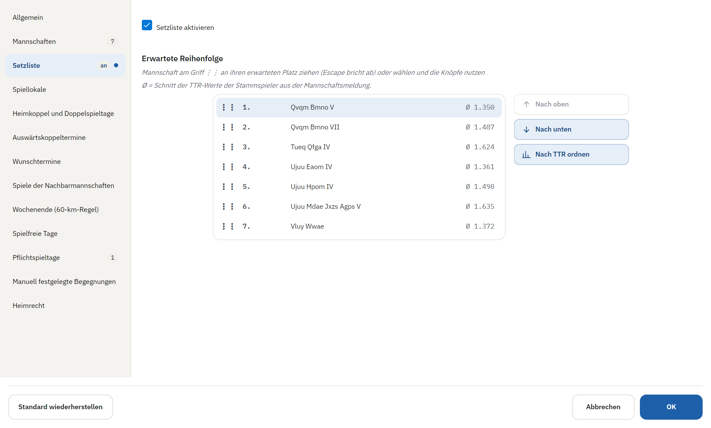

### Spiellokale

click-TT überträgt keine Spiellokale. Meist ist das egal, weil die Vereine nur eine Halle haben. Stehen mehrere Hallen zur Verfügung, braucht das Programm die Spiellokale, damit die maximale Zahl gleichzeitiger Heimspiele je Halle eingehalten wird.

Je Mannschaft tragen Sie das **Standardspiellokal** ein („nur eines“, wenn der Verein nur in einer Halle spielt; sonst *Spiellokal 1* bis *5*, die Nummern der Spiellokale des Vereins in click-TT) und darunter, falls nötig, abweichende Spiellokale für einzelne Heimspieltage (*Standard* = das Standardspiellokal). Die Tabelle **Spiellokale der Nachbarmannschaften** enthält das Standardspiellokal jeder Nachbarmannschaft; spielt eine Nachbarmannschaft nur bei einzelnen Spielen woanders, öffnet ein Doppelklick auf ihren Namen die Bearbeitung.

### Heimkoppel und Doppelspieltage

Vor allem in höheren Ligen möchten Mannschaften an einem Wochenende zwei Spiele bestreiten. Die Meldungen dazu sind kompliziert und nicht immer eindeutig; das Programm leitet ab, was vermutlich gemeint ist. **Bitte immer kontrollieren.**

- **Heimkoppel:** zwei Heimspiele an einem Tag. click-TT erlaubt je Tag nur eine Uhrzeit; das Programm legt deshalb automatisch einen zweiten Termin vier Stunden davor oder danach an. Die tatsächliche Uhrzeit des zweiten Spiels tragen Sie später in click-TT nach.
- **Doppelspieltag:** zwei Heimspiele an zwei aufeinanderfolgenden Tagen, meist Samstag und Sonntag. Möglich ist das, wenn die Mannschaft an beiden Tagen einen Wunschtermin hat. Je Terminpaar legen Sie fest, ob der Doppelspieltag gewünscht, möglich oder nicht gewünscht ist; vorbelegt ist, was die Mannschaft in click-TT angegeben hat.

Diese Seite fasst die Koppeloptionen aller Wunschtermine zusammen. Neue Koppeltermine und die zweite Anfangszeit legen Sie in den **Wunschterminen** an.

### Auswärtskoppeltermine

Hier geben Mannschaften an, bei welchen zwei Gegnern sie an einem Wochenende auswärts spielen möchten – meist, um eine lange Anfahrt nur einmal zu machen. Je Wunsch legen Sie fest, ob beide Spiele an **einem Tag**, an **zwei Tagen** (mit Übernachtung) oder wahlweise stattfinden sollen. Für einen Gegner sind auch mehrere Wünsche möglich.

Sollen beide Spiele an einem Tag stattfinden, braucht es genug Abstand zwischen den Anfangszeiten. Meist spielen die Mannschaften aber zu festen Zeiten; das Programm darf deshalb bei einer der beteiligten Heimmannschaften die Anfangszeit verschieben. Unter **Alternative Anfangszeiten** legen Sie fest, an welchen Terminen welcher Mannschaft das erlaubt ist; das leere Feld zeigt den Vorschlag (z. B. „z. B. 14:00“), **Vorschläge für alle eintragen** übernimmt ihn überall, **Alle Zeiten leeren** entfernt alle. Die genaue zweite Uhrzeit steht im jeweiligen Wunschtermin.

### Wunschtermine

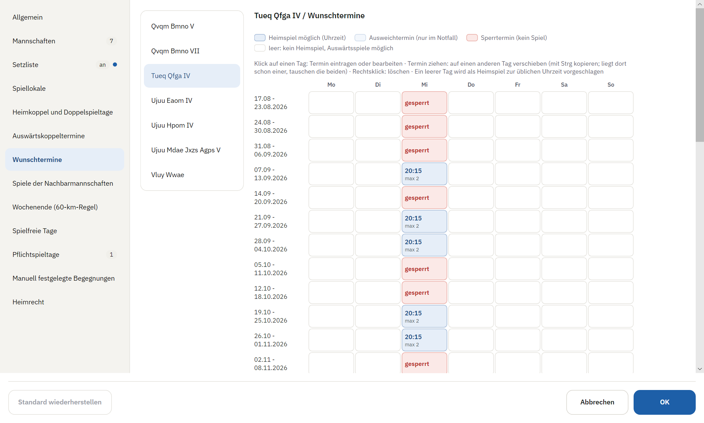

Je Mannschaft alle Tage der Saison, wochenweise, als Kärtchen (die Legende steht darüber):

- **blau mit Uhrzeit** (z. B. `18:00`): an diesem Tag ist ein Heimspiel möglich; darunter klein die Zusätze (Koppel, Doppel, max. Heimspiele, Spiellokal);
- **hellblau, Uhrzeit kursiv**: Ausweichtermin, nur im Notfall;
- **rot „gesperrt“**: Sperrtermin, die Mannschaft möchte an diesem Tag nicht spielen;
- **leer (weiß)**: an diesem Tag ist ein Auswärtsspiel möglich.

Ein **Klick** auf einen Tag – oder die **rechte Maustaste** und dann **Bearbeiten …** – öffnet den Termin. Oben wählen Sie mit einem Umschalter **Heimspiel möglich**, **kein Heimspiel (Auswärtsspiele möglich)** oder **Sperrtermin**; beim Heimspiel stehen darunter Uhrzeit, Halle, Koppel- und Auswärtskoppeloptionen. Ein **leerer** Tag ist dabei gleich als Heimspiel zur üblichen Uhrzeit der Mannschaft vorgeschlagen (der häufigsten an diesem Wochentag, sonst 18:00) – meist genügt dann **OK**. Einen Termin **ziehen** Sie einfach auf einen anderen Tag: Das Kärtchen hängt am Mauszeiger, der Zieltag ist umrandet. Mit gedrückter **Strg**-Taste wird kopiert statt verschoben; liegt am Zieltag schon ein Termin, tauschen die beiden; Escape bricht ab. Der Tooltip eines Kärtchens nennt Tag und Termin ausgeschrieben.

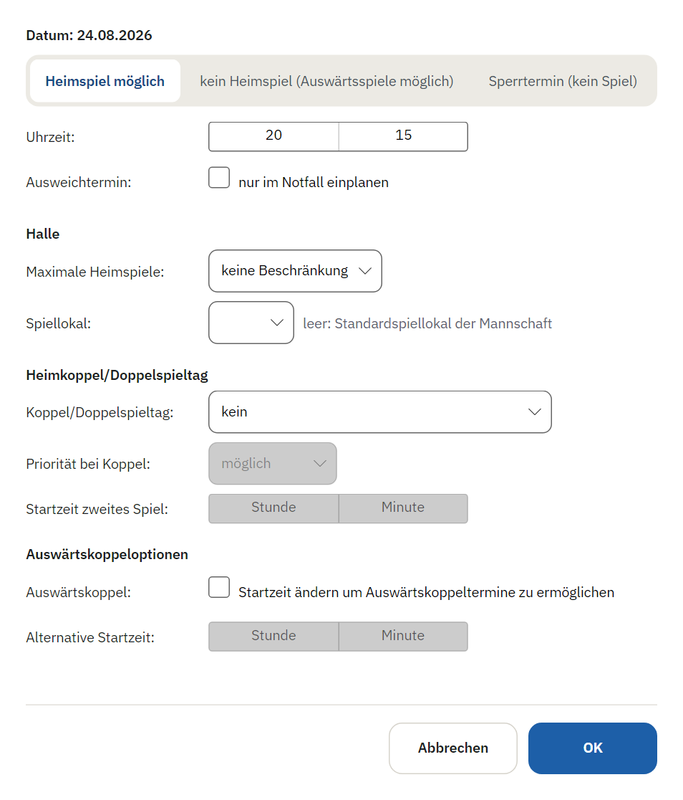

Die Optionen eines Termins:

| Option | Bedeutung |
|---|---|
| **Ausweichtermin** | Nur im Notfall einplanen (Kostenart *Ausweichtermine*). |
| **Maximale Heimspiele** | So viele Mannschaften können gleichzeitig in dieser Halle spielen (Kostenart *Hallenbelegung*). |
| **Spiellokal** | Abweichend vom Standardspiellokal der Mannschaft. |
| **Koppel/Doppelspieltag** | Zwei Spiele an einem Tag bzw. an zwei aufeinanderfolgenden Tagen. Für einen Doppelspieltag muss auch der Folgetag als Doppelspieltag gekennzeichnet sein. |
| **Priorität bei Koppel** | Wie dringend der Koppeltermin eingeplant werden soll (wirkt auf die Kostenart *Heimkoppel*). |
| **Startzeit zweites Spiel** | Die zweite Anfangszeit bei einem Koppeltermin an einem Tag. |
| **Auswärtskoppel** | Eine mögliche andere Anfangszeit, damit Auswärtskoppeltermine an einem Tag möglich werden. |

### Spiele der Nachbarmannschaften

Die Spiele der Nachbarmannschaften braucht das Programm für die Hallenbelegung und damit benachbarte Mannschaften nicht zu oft am selben Tag spielen. Hier legen Sie Nachbarmannschaften an, bearbeiten oder löschen sie. Je Nachbarmannschaft lässt sich einstellen:

- **Gleichzeitige (parallele) Spiele mit dieser Mannschaft vermeiden** – zum Beispiel, weil dieselben Spieler aushelfen;
- **Gleichzeitige (parallele) Heimspiele mit dieser Mannschaft sind erwünscht** – zum Beispiel, wenn ein Verein für die Wochenenden eigens eine Halle anmietet und möglichst wenige Hallentage haben möchte;

dazu die einzelnen **Begegnungen** dieser Mannschaft.

### Wochenende (60-km-Regel)

Ist die Anfahrt zu einem Gegner zu weit, sollen die Spiele gegen ihn am Wochenende stattfinden. Hier legen Sie fest, für welche Paarungen das gilt. Ob der Freitag zum Wochenende zählt, stellen Sie in den **Einstellungen** ein.

Sind die Terminwünsche (PDF) übernommen (siehe [3.3](#33-die-staffel-einrichten)), steht neben jedem Gegner die Entfernung der Hallen in Luftlinie. Die Marke **weit** zeigt einen Gegner über 60 km ohne Häkchen, der auch unter der Woche Heimspiele hat; **nah** ein Häkchen bei höchstens 60 km. Beides sind nur Hinweise. Unter der Liste steht die Summe der Entfernungen zu allen Gegnern (je einfache Strecke).

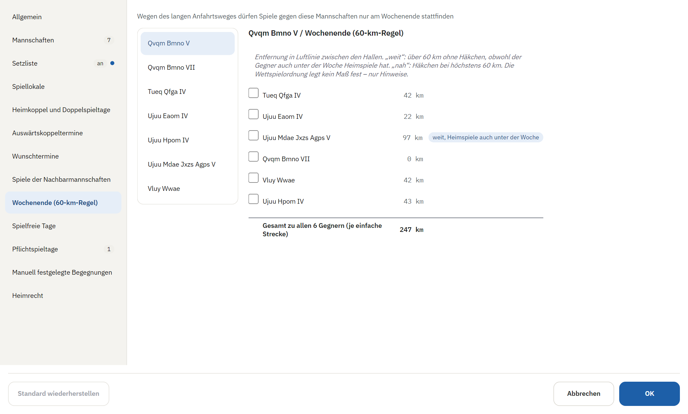

### Spielfreie Tage

An einzelnen Tagen soll gar nicht gespielt werden – etwa weil die Relegationstermine noch nicht feststanden, weil nachträglich ein Spielverbot beschlossen wurde oder weil beim Anlegen der Spieltage ein Fehler passiert ist. Diese Tage wählen Sie in einem **Monatskalender** der Saison: Ein Klick auf einen Tag macht ihn spielfrei (rot), ein zweiter gibt ihn wieder frei. Wählbar sind die Tage, an denen Mannschaften Heimspielwünsche haben. Grau sind Tage, die **nicht gesperrt** sind, an denen aber keine Mannschaft einen Heimspielwunsch hat – dort wird ohnehin nicht gespielt; ist ein solcher Tag trotzdem als spielfrei eingetragen (etwa aus click-TT), ist er rot unterstrichen. Der Tooltip eines Tages nennt den Grund, die Legende steht über dem Kalender; Wochenenden sind fett. Die Monate brechen um, wenn das Fenster schmaler ist. Die Auswertung der Terminwünsche berücksichtigt die spielfreien Tage.

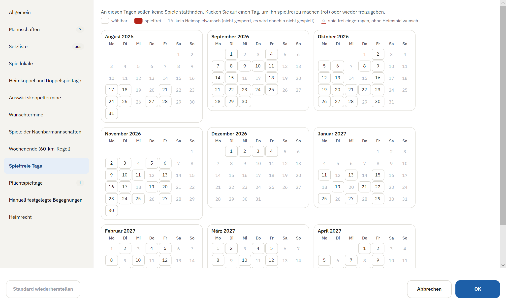

### Pflichtspieltage

Hier legen Sie fest, wie viele Spiele jede Mannschaft in einem Zeitraum mindestens machen muss – etwa mindestens ein Spiel zwischen dem 14. und 18. April oder mindestens drei Spiele im November.

Setzen Sie Pflichtspieltage sparsam ein: Sie nehmen dem Programm Freiheit und verschlechtern den Plan meist. Sinnvoll sind sie vor allem für einen gemeinsamen letzten Spieltag, falls das Programm ihn nicht ohnehin so plant. Bei **ungerader Mannschaftszahl** muss am Pflichtspieltag zwangsläufig eine Mannschaft pausieren. Das Original bestraft diese Mannschaft immer; AndiGenerator.NET lässt in einem Pflichtzeitraum mit einem Spiel genau eine fehlende Mannschaft zu, wenn sie in der Woche davor gespielt hat – sie spielt dann also am vorletzten Spieltag. Abschalten lässt sich das in den **Einstellungen** (*Bei ungerader Mannschaftszahl darf am Pflichtspieltag eine Mannschaft spielfrei sein …*); dann gilt die Strafe wie im Original.

### Manuell festgelegte Begegnungen

Stehen Spiele schon vor der Planung fest – etwa weil zwei befreundete Vereine immer am Tag des Weinfests gegeneinander spielen –, tragen Sie sie hier mit Datum, Uhrzeit und Spiellokal ein. Der Plan wird um diese Spiele herum erstellt.

### Heimrecht

Manchmal soll die Zahl der Heimspiele in Vor- und Rückrunde nicht gleich sein, oder das Heimrecht gegen bestimmte Gegner soll in einer bestimmten Runde liegen – etwa weil eine Halle saniert wird oder weil Jugendligen zur Rückrunde neu zusammengestellt werden. Hier geben Sie je Mannschaft die Anzahl der Heimspiele und das Heimrecht gegen einzelne Gegner vor – je Gegner mit dem Umschalter **Vorrunde / egal / Rückrunde**.

Zu beachten:

- Soll eine Mannschaft in einer Runde nur Heim- oder nur Auswärtsspiele haben, steigen ihre Kosten für den Wechsel von Heim- und Auswärtsspielen stark an. Stellen Sie *Wechsel H/A* für diese Mannschaft dann auf **Nicht berücksichtigen**.
- Ob die Vorgaben überhaupt erfüllbar sind, prüft das Programm nicht. Es ließe sich zum Beispiel eingeben, dass sowohl A gegen B als auch B gegen A das Heimrecht in der Vorrunde hat.

## 10. Tipps und häufige Fragen

**Wie erkenne ich Spiele ohne Termin?**
In der Qualitätsansicht unter A1, an sehr hohen Gesamtkosten und im Terminplan: Spiele ohne Termin stehen dort immer ganz oben.

**Kann eine Mannschaft zwei Spiele gleichzeitig haben?**
Nein, das wäre ein Programmfehler. Pokalspiele überträgt click-TT allerdings nicht; Überschneidungen mit Pokalspielen kann das Programm deshalb nicht verhindern. Pokalspiele werden aber üblicherweise später angesetzt.

**Das Programm findet keine Verbesserung mehr.**
Das Programm verbessert den Plan durch viele kleine Tauschaktionen. Manchmal müsste es aber viele Spiele auf einmal tauschen, um weiterzukommen, und scheint sich im aktuellen Plan „festgebissen“ zu haben. Dann hilft ein Umweg:

1. Den aktuellen Plan **merken** – vielleicht war er doch der bessere.
2. Die störende Kostenart vorübergehend auf **sehr hoch** oder **extrem hoch** setzen und warten, bis sie deutlich gesunken ist. Der Plan ist dann in anderer Hinsicht wahrscheinlich schlechter.
3. Die Gewichtung schrittweise zurücknehmen und die übrigen nachjustieren, bis wieder ein ausgewogener Plan entsteht.

So geben Sie dem Programm einen Wink, in welcher Richtung es suchen soll. Übrigens macht das Programm selbst Ähnliches: Nach einiger Zeit rechnet eine eigene Suchgruppe mit einer extrem gewichteten Kostenart und bietet ihre Ergebnisse den anderen an.

**Kann ich mehrere Staffeln gleichzeitig planen?**
Nein. Das Programm berücksichtigt die Spiele der anderen Staffeln – aber nur die, die beim Herunterladen der XML-Datei schon in click-TT standen. Planen Sie die Staffeln deshalb nacheinander: Staffel planen, in click-TT importieren, dann die XML-Datei der nächsten Staffel herunterladen.

**Hallenbelegung und parallele Spiele außerhalb des BTTV**
Im Bayerischen TTV werden Hallenbelegung und Spiele der Nachbarmannschaften bei der Planung berücksichtigt, in anderen Verbänden traditionell nicht. Die Angabe der maximalen Heimspiele ist in click-TT zwar überall möglich, wird außerhalb des BTTV aber oft ohne Bedeutung ausgefüllt und taugt dann nicht für die Berechnung. Korrigieren Sie die Werte in den Wunschterminen oder stellen Sie *Hallenbelegung* und *parallele Spiele* in den Einstellungen auf **Nicht berücksichtigen**.

**Wird mein Rechner während der Generierung langsam?**
Das Programm lässt einen Prozessorkern frei und rechnet mit niedriger Priorität, damit andere Programme bedienbar bleiben. Wer den Rechner in Ruhe lassen möchte, pausiert die Generierung.

**Das Programm meldet einen unerwarteten Fehler.**
Dann ist etwas schiefgegangen, womit das Programm nicht gerechnet hat. Es beendet sich dabei nicht, sondern merkt den aktuellen Plan als **Notfallsicherung** (Sie finden ihn unter **Start mit** und in der Planauswahl der Ansichten) und schreibt die Einzelheiten in die Datei `fehlerprotokoll.txt` im Datenordner (unter Windows `%LOCALAPPDATA%\AndiGenerator.NET`); die Meldung nennt den genauen Pfad. Sie können weiterarbeiten, sicherer ist aber, den Plan zu exportieren oder zu merken und das Programm neu zu starten. Bricht eine laufende Generierung ab, steht das in der Statuszeile, und der beste Plan ist ebenso als Notfallsicherung gemerkt. Helfen Sie, den Fehler zu beheben: Schicken Sie das Fehlerprotokoll mit einer kurzen Beschreibung, was Sie gerade getan haben, über die [Fehlermeldungen auf GitHub](https://github.com/PBuchmann/AndiGenerator.NET/issues). Das Protokoll enthält keine Spielplandaten, kann aber Dateipfade Ihres Rechners nennen.

---

*AndiGenerator.NET – Portierung des AndiGenerators von Andreas Hofmann. Freie Software unter der GNU General Public License Version 3.*
